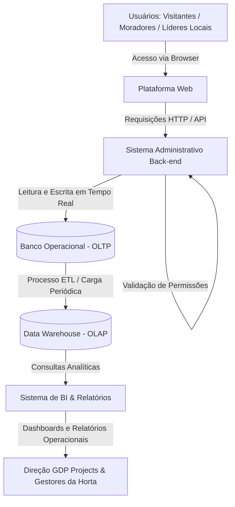
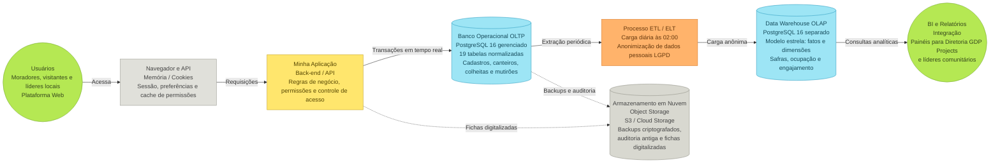

# Sistema de Hortas Comunitárias

## Descrição do projeto

O **Cultiva Plus** é uma plataforma voltada para o gerenciamento de hortas comunitárias, promovendo uma rede de cultivo colaborativo entre moradores, comunidades e responsáveis pelas hortas. A solução busca facilitar a organização dos espaços, o acompanhamento dos cultivos e a participação dos membros, tornando o processo mais simples, acessível e colaborativo.

Por meio da tecnologia, o Cultiva Plus conecta pessoas interessadas em cultivar, compartilhar conhecimentos e contribuir para o desenvolvimento de hortas comunitárias, incentivando a sustentabilidade, o aproveitamento de espaços e o fortalecimento da comunidade.

## Objetivo da solução

O objetivo do **Cultiva Plus** é facilitar o gerenciamento de hortas comunitárias por meio de uma plataforma colaborativa que centraliza informações, organiza atividades e conecta os participantes. A solução busca tornar a gestão dos cultivos mais eficiente, incentivar a participação da comunidade e promover práticas sustentáveis de cultivo e compartilhamento.

## Estrutura do projeto

```bash
cultiva-plus/
└── README.md
```

## Integrantes da equipe

* Daniel Alonso Oliveira Soares
* João Pablo Silva Pinheiro
* Erick Sales Ramos
* Antonio Gabriel Gomes Falcao do Nascimento
* Rafael Jesus Bezerra Cerqueira
* Alexandre Roque Pereira Costa
* Breno Kayan Souza de Azevedo

# Empresa: GDP Projects

## Segmento de Atuação

Desenvolvimento de software, inteligência artificial e soluções digitais sob medida. Criação de chatbots, landing pages, plataformas web e sistemas de gestão para pequenas empresas e iniciativas comunitárias.

## Missão

Impulsionar pequenos negócios e iniciativas locais com soluções digitais acessíveis, inteligentes e eficientes. Transformação de necessidades operacionais em tecnologia prática.

## Visão

Reconhecimento como consultoria de desenvolvimento ágil e inovadora, referência na criação de soluções digitais para micro e pequenas empresas até 2028.

## Valores

* Inovação adaptativa
* Acessibilidade digital
* Foco no cliente e no impacto do negócio
* Agilidade e entrega de valor

## Produtos e Serviços

* **Desenvolvimento Web:** landing pages, sites institucionais e e-commerces para pequenas empresas.
* **Automação e Inteligência Artificial:** chatbots para atendimento, vendas e suporte operacional.
* **Sistemas sob medida:** plataformas de gestão como o Cultiva Plus.

## Clientes

Micro e pequenas empresas de diversos setores, empreendedores individuais e gestores de projetos comunitários.

## Fornecedores e Parceiros

Atualmente não possui parceiros cadastrados. Estrutura aberta para integração com provedores de nuvem, APIs de terceiros e agências de marketing.

## Organograma

* **Direção Executiva:** Daniel Alonso Oliveira Soares
* **Gestão de Produtos e Projetos:** João Pablo Silva Pinheiro
* **Desenvolvimento Back-end e IA:** Erick Sales Ramos e Antonio Gabriel Gomes Falcão do Nascimento
* **Desenvolvimento Front-end e UX/UI:** Rafael Jesus Bezerra Cerqueira
* **Infraestrutura e DevOps:** Alexandre Roque Pereira Costa
* **Marketing e Atendimento ao Cliente:** Breno Kayan Souza de Azevedo

## Principais Processos

1. **Levantamento de Requisitos e Escopo:** mapeamento das necessidades do cliente para landing pages, bots ou sistemas.
2. **Desenvolvimento e Testes:** construção iterativa de aplicações web e fluxos de automação.
3. **Implantação e Suporte:** publicação de projetos, configuração de hospedagem e manutenção contínua.
4. **Gestão de Relacionamento:** prospecção de novos clientes e acompanhamento pós-entrega.

# Análise de Dados e Necessidades do Sistema

## Quais dados o sistema produz e utiliza?

No **Cultiva Plus**, trabalhamos com dados relacionados ao gerenciamento das hortas comunitárias e à participação dos membros. Entre os principais dados utilizados pelo sistema estão:

* Informações das hortas e dos espaços disponíveis;
* Informações sobre os cultivos;
* Dados dos participantes e membros;
* Informações sobre as atividades realizadas;
* Dados de acompanhamento e organização dos cultivos;
* Informações relacionadas à participação dos membros.

Esses dados são utilizados para manter as informações centralizadas e facilitar a organização e o gerenciamento das hortas.

## Quem utiliza esses dados?

Os dados do Cultiva Plus são utilizados pelos diferentes participantes envolvidos nas hortas comunitárias, principalmente:

* Moradores;
* Membros das comunidades;
* Responsáveis pelas hortas;
* Gestores de projetos comunitários.

Nossa equipe também utiliza informações relacionadas ao funcionamento da plataforma quando necessário para atividades de implantação, suporte e manutenção do sistema.

## Onde os dados são armazenados?

O armazenamento dos dados ainda será definido durante o desenvolvimento do projeto. Como o Cultiva Plus será uma plataforma web, precisamos definir a infraestrutura e a solução de armazenamento mais adequadas para manter as informações utilizadas pelo sistema.

Essa decisão também deverá considerar as necessidades de hospedagem, manutenção e disponibilidade da plataforma.

## Dados sensíveis

Neste momento, o Cultiva Plus não prevê a utilização de dados sensíveis.

Como o sistema trabalha com informações de participantes e membros das hortas, vamos definir quais dados pessoais serão realmente necessários para o funcionamento da plataforma, evitando a coleta de informações desnecessárias.

## Problemas relacionados aos dados

Um dos objetivos do Cultiva Plus é resolver problemas relacionados à organização e ao gerenciamento das informações das hortas comunitárias. Entre os principais problemas que identificamos estão:

* Informações das hortas descentralizadas;
* Dificuldade para acompanhar os cultivos;
* Dificuldade na organização das atividades;
* Informações que podem ficar desatualizadas;
* Dificuldade para acompanhar a participação dos membros;
* Falta de um ambiente centralizado para compartilhamento das informações.

Nossa proposta é centralizar essas informações em uma única plataforma, facilitando o acesso e a organização dos dados.

## Riscos

Durante o desenvolvimento e utilização do Cultiva Plus, consideramos alguns riscos relacionados aos dados e ao funcionamento da plataforma:

* Perda de informações das hortas e dos cultivos;
* Informações incorretas ou desatualizadas;
* Acesso inadequado às informações dos participantes;
* Falhas na organização dos dados cadastrados;
* Indisponibilidade temporária da plataforma;
* Problemas relacionados à hospedagem e manutenção;
* Dependência futura de serviços externos, como provedores de nuvem e APIs de terceiros.

Esses riscos deverão ser considerados durante as etapas de desenvolvimento, implantação e manutenção do sistema.

## Necessidades do negócio

Para que o Cultiva Plus cumpra seu objetivo, identificamos como principais necessidades do negócio:

* Centralizar as informações das hortas comunitárias;
* Facilitar o gerenciamento dos espaços;
* Permitir o acompanhamento dos cultivos;
* Organizar as atividades realizadas nas hortas;
* Facilitar a participação dos membros;
* Conectar moradores, comunidades e responsáveis;
* Melhorar o compartilhamento de informações;
* Tornar a gestão dos cultivos mais eficiente;
* Incentivar a participação da comunidade;
* Promover práticas sustentáveis;
* Facilitar o compartilhamento de conhecimentos;
* Garantir condições para implantação, hospedagem, manutenção e suporte da plataforma.

Com essas necessidades, buscamos desenvolver o **Cultiva Plus** como uma plataforma simples, acessível e colaborativa, capaz de melhorar a organização das hortas comunitárias e facilitar a participação de todos os envolvidos.

## Arquitetura de Dados (Entrega 1)

Atendendo às diretrizes da **Entrega 1 — Arquitetura de Dados**, esta seção apresenta a visão macro do sistema, o fluxo das informações e a divisão de responsabilidades entre os bancos transacional e analítico.

### A. Mapeamento dos Sistemas (Componentes da Arquitetura)
Para resolver a descentralização das informações e estruturar a gestão colaborativa, a arquitetura macro do **Cultiva Plus** é composta por:

1. **Plataforma Web (Front-end):** Interface responsiva para moradores, líderes comunitários, gestores e visitantes.
2. **Sistema Administrativo (Back-end / API):** Camada de serviços responsável pelas regras de negócio e controle da Matriz de Perfis e Permissões.
3. **Banco de Dados Operacional (OLTP):** Banco relacional para armazenamento de dados dinâmicos em tempo real (cadastros, canteiros, presença em mutirões e tarefas).
4. **Data Warehouse (OLAP):** Repositório analítico para consolidação do histórico de safras, uso de espaços e engajamento comunitário.
5. **Sistema de BI & Relatórios:** Módulo para geração de dashboards e relatórios operacionais para a GDP Projects e líderes locais.
6. **Infraestrutura e Nuvem:** Provedores de hospedagem web, manutenção e suporte para integração com APIs externas.

### B. Desenho do Fluxo de Dados
O fluxo a seguir mapeia a circulação da informação entre os componentes do sistema:



### C. Transacional (OLTP) vs. Analítico (OLAP)
A separação funcional entre os bancos transacional e analítico atende às diferentes demandas operacionais e estratégicas da plataforma:

| Critério | Banco Operacional (OLTP) | Data Warehouse (OLAP) |
| :--- | :--- | :--- |
| **Escopo Principal** | Operações rotineiras da plataforma em tempo real. | Análise histórica e consolidação centralizada de informações. |
| **Responsabilidade no Sistema** | Processar cadastros, registrar presenças em mutirões, atualizar status de tarefas e aplicar permissões. | Armazenar histórico de safras, mensurar a evolução do uso dos espaços e apoiar o planejamento de novos cultivos. |
| **Perfil das Operações** | Transações simultâneas rápidas de leitura e escrita com pequeno volume por operação. | Consultas analíticas pesadas, agregações de dados e relatórios consolidados. |
| **Público-Alvo Direto** | Moradores, Líderes Locais, Visitantes e a API do sistema. | Direção Executiva e Gestores de Produtos/Projetos da GDP Projects e Líderes Comunitários. |

---

## Matriz de Perfis e Permissões
*   Gestor de Projetos / Administrador Geral (GDP Projects / Responsável pela Horta):
    * Escopo de Acesso: Controle total e centralizado.
    * Ações Permitidas: Aprovação de novos membros, concessão e revogação de permissões, gerenciamento e exclusão de hortas/canteiros, visualização de relatórios operacionais completos e logs de auditoria do sistema.

*   Responsável pela Horta (Líder Comunitário Local):
    * Escopo de Acesso: Restrito à(s) horta(s) sob sua gestão.
    * Ações Permitidas: Cadastro de canteiros/cultivos, atribuição de tarefas a membros, atualização do status das atividades e moderação da comunicação local.

*   Membro Participante / Morador:
    * Escopo de Acesso: Consulta e registro operacional básico.
    * Ações Permitidas: Visualização de hortas públicas/locais, confirmação de presença em mutirões, registro de tarefas concluídas e leitura de dicas de cultivo.

*   Visitante (Não autenticado):
    * Escopo de Acesso: Somente leitura pública.
    * Ações Permitidas: Visualização do mapa geral das hortas ativas, objetivos do projeto e página de cadastro/solicitação de entrada.

## Modelagem de Dados (Entrega 2)

Atendendo à **Entrega 2 — Data Modeling**, criamos o modelo lógico de **cada sistema** levantado na Entrega 1, coerente com a arquitetura acima. A documentação completa está em [`docs/entrega-2-data-modeling/`](docs/entrega-2-data-modeling/README.md).

| Sistema (Entrega 1) | Modelo lógico | Documento |
|---|---|---|
| Plataforma Web | Sessão, *view models* e formulários (não armazena dados permanentes) | [01-plataforma-web.md](docs/entrega-2-data-modeling/01-plataforma-web.md) |
| Sistema Administrativo (API) | Recursos/DTOs, verificação de permissões e regras de negócio | [02-sistema-administrativo-api.md](docs/entrega-2-data-modeling/02-sistema-administrativo-api.md) |
| Banco Operacional (OLTP) | Relacional normalizado (3FN) com 19 entidades | [03-banco-operacional-oltp.md](docs/entrega-2-data-modeling/03-banco-operacional-oltp.md) |
| Data Warehouse (OLAP) | Esquema estrela: 5 fatos e 6 dimensões + ETL incremental | [04-data-warehouse-olap.md](docs/entrega-2-data-modeling/04-data-warehouse-olap.md) |
| Sistema de BI & Relatórios | Camada semântica (views), KPIs e acesso por horta | [05-bi-relatorios.md](docs/entrega-2-data-modeling/05-bi-relatorios.md) |
| Infraestrutura e Nuvem | Implantação, usuários de banco, controle de cargas, backup e retenção | [06-infraestrutura-nuvem.md](docs/entrega-2-data-modeling/06-infraestrutura-nuvem.md) |

**Entidades principais:** Usuário, Comunidade, Horta, Membro da Horta, Solicitação de Entrada, Canteiro, Espécie, Cultivo, Colheita, Mutirão, Presença em Mutirão e Tarefa (mais 7 entidades de apoio: perfis, permissões, tipos de tarefa, dicas, avisos e auditoria).

**Data Warehouse em uma frase:** todo dia às 02:00, o ETL lê do banco operacional (com um usuário somente leitura e sem dados pessoais) apenas o que mudou, monta o histórico de safras, ocupação dos canteiros e engajamento, e o BI usa esse histórico para os dashboards da GDP Projects e dos líderes das hortas.

# Entrega 4 — Contribuição da Data Architecture e do Data Modeling

## 1. Introdução

A arquitetura e a modelagem de dados propostas para o Cultiva Plus contribuem diretamente para os objetivos da GDP Projects, permitindo desenvolver uma plataforma organizada, segura e eficiente para a gestão de hortas comunitárias.
A integração entre os sistemas e uso adequado das informações facilitam o gerenciamento de hortas, canteiros, cultivos, atividades e participantes, promovendo a colaboração entre os membros da comunidade.

## 2. Contribuição da Data Architecture

A Data Architecture define como os sistemas do Cultiva Plus se comunicam e como as informações circulam entre eles.
A utilização de uma plataforma web integrada a uma API e a um banco de dados operacional permite centralizar as informações, reduzir inconsistências e facilitar o acesso aos registros.
Além disso, a arquitetura estabelece mecanismos de validação e controle de permissões, garantindo que cada participante tenha acesso apenas às funcionalidades e informações autorizadas.
Essa organização contribui para a eficiência operacional, a segurança dos dados e a possibilidade de expansão da plataforma.

## 3. Contribuição do Data Modeling

O Data Modeling complementa a arquitetura ao definir como as informações serão organizadas e relacionadas dentro do banco de dados.
No Cultiva Plus, entidades como usuários, hortas, canteiros, cultivos, tarefas e participações precisam possuir relacionamentos bem definidos para garantir a integridade das informações.
Por exemplo, relacionar cada cultivo ao seu respectivo canteiro e cada tarefa à horta correspondente facilita o acompanhamento das atividades e evita registros inconsistentes.
Uma modelagem adequada também reduz a duplicação desnecessária de dados, melhora a manutenção do sistema e facilita a implementação de novas funcionalidades.

## 4. Apoio à tomada de decisões

A arquitetura proposta também prevê a possibilidade de implementar futuramente um Data Warehouse e ferramentas de Business Intelligence (BI).
Esses recursos poderão transformar registros operacionais em indicadores, permitindo analisar a evolução dos cultivos, a quantidade de atividades realizadas e a participação dos membros ao longo do tempo.
Com essas informações, os responsáveis poderão identificar necessidades, planejar melhorias e acompanhar os resultados das iniciativas comunitárias.

## 5. Alinhamento com os objetivos da GDP Projects

A arquitetura e a modelagem propostas estão alinhadas aos valores da GDP Projects, especialmente à inovação adaptativa, acessibilidade digital, agilidade e entrega de valor.
A centralização dos dados e a organização das funcionalidades contribuem para oferecer uma solução acessível às comunidades, enquanto a estrutura modular facilita futuras melhorias e adaptações.
Dessa forma, o Cultiva Plus contribui para a missão da empresa de transformar necessidades operacionais em soluções digitais eficientes, além de apoiar sua visão de crescimento e reconhecimento no mercado.

## 6. Conclusão

A Data Architecture e o Data Modeling são fundamentais para que o Cultiva Plus alcance seus objetivos de negócio.

Entrega 5 — Data Storage

De forma resumida, o Cultiva Plus guarda seus dados em dois bancos principais: o banco operacional, que a plataforma usa o tempo todo, e o Data Warehouse, que guarda o histórico usado nos relatórios. Além deles, temos um espaço na nuvem para os backups, algumas informações temporárias no navegador e na API, e as fichas em papel que já descrevemos no modelo de gestão documental física.

A. Armazenamento
1. Banco operacional (cultiva_oltp)

Qual tecnologia vamos usar? Vamos usar o PostgreSQL 16, contratado como serviço gerenciado em um provedor de nuvem (por exemplo Amazon RDS, Google Cloud SQL, Azure ou Supabase). "Gerenciado" significa que o provedor cuida da instalação, das atualizações e dos backups automáticos do servidor.

Por que escolhemos essa tecnologia? Escolhemos o PostgreSQL por alguns motivos:

Ele é gratuito e open source, o que combina com o nosso público: hortas comunitárias e iniciativas com pouco orçamento.
É um banco relacional, ideal para dados que se ligam entre si, como horta → canteiro → cultivo → colheita.
Garante que operações com várias etapas aconteçam por completo ou não aconteçam. Quando um líder aprova um novo membro, por exemplo, o sistema muda quatro tabelas ao mesmo tempo; se qualquer etapa falhar, nada é gravado pela metade.
O próprio banco consegue recusar dados errados (como uma colheita com quantidade negativa), mesmo que a API tenha algum problema.
Está disponível em praticamente todos os provedores de nuvem, então não ficamos presos a nenhum deles.

Optamos pelo serviço gerenciado porque somos uma equipe pequena e não teríamos tempo para cuidar sozinhos da manutenção de um servidor de banco de dados.

Quais dados serão armazenados? Todos os dados do dia a dia da plataforma: usuários, perfis e permissões, comunidades, hortas, canteiros, espécies de plantas, cultivos, colheitas, mutirões, presenças, tarefas, dicas, avisos, pedidos de entrada e o registro de auditoria (quem fez o quê e quando). É também o único lugar onde ficam dados pessoais, como nome, e-mail e telefone. A senha nunca é guardada como texto, apenas de forma criptografada.

Como os dados serão organizados? Os dados ficam em 19 tabelas, divididas em quatro grupos: acesso e pessoas, espaços e cultivos, atividades, e conteúdo e controle. As tabelas seguem a modelagem normalizada da Entrega 2, ou seja, cada informação é guardada em um único lugar para evitar repetição. Toda tabela tem um código de identificação próprio, e as tabelas que podem ser alteradas guardam a data da última modificação, o que permite ao Data Warehouse saber o que mudou.

Qual será o volume esperado? Fizemos uma estimativa considerando dois momentos: o primeiro ano, como projeto piloto, e o terceiro ano, com a plataforma já expandida.

Para os cálculos, consideramos 15 canteiros por horta, 3 plantios por canteiro ao ano, 4 colheitas por plantio, 2 mutirões por mês em cada horta com cerca de 15 participantes, e 20 tarefas por mês por horta.

É um volume pequeno para o PostgreSQL. O que mais cresce é o registro de auditoria, por isso ele tem regras próprias de limpeza e arquivamento.

Como o sistema pode crescer? A ideia é crescer aos poucos, só quando houver necessidade:

Se o servidor começar a ficar sobrecarregado, aumentamos a capacidade da máquina (mais memória e processamento). No serviço gerenciado isso é só uma mudança de configuração.
Se muitas pessoas acessarem ao mesmo tempo, colocamos um gerenciador de conexões entre a API e o banco, para reaproveitar as conexões.
Se as telas de consulta ficarem lentas, criamos uma cópia do banco só para leitura: as consultas vão para a cópia e as gravações continuam no banco principal.
Se o registro de auditoria ficar muito grande, dividimos a tabela por ano e mandamos os anos antigos para um armazenamento mais barato.
2. Data Warehouse (cultiva_dw)

Qual tecnologia vamos usar? Também o PostgreSQL 16, mas em um banco separado. No começo ele pode ficar no mesmo servidor do banco operacional; quando o volume crescer, passa para um servidor próprio.

Por que escolhemos essa tecnologia? Para o volume que esperamos, o PostgreSQL dá conta tranquilamente e não tem custo de licença. Usar a mesma tecnologia nos dois bancos também simplifica o trabalho da equipe: é uma só linguagem, uma só forma de fazer backup e o processo de carga (ETL) roda dentro do próprio banco, sem precisar de outra ferramenta. Mantemos o DW separado do banco operacional para que os relatórios pesados não deixem a plataforma lenta para quem está usando.

Quais dados serão armazenados? Somente os dados úteis para análise e sem nenhuma informação pessoal: o histórico de colheitas, de plantios, da ocupação dos canteiros mês a mês, da participação nos mutirões e das tarefas. Os membros aparecem apenas como um número, sem nome, e-mail ou telefone.

Como os dados serão organizados? O DW é dividido em quatro áreas:

stg (área de preparação): recebe uma cópia temporária do que mudou no banco operacional.
dw: o histórico organizado no modelo estrela da Entrega 2, com as tabelas de fatos (os números, como kg colhidos) e as dimensões (o contexto, como horta, espécie e data).
bi: as visões prontas usadas pelos painéis de relatórios.
etl: o controle das cargas (quando rodaram, se deram certo e até onde já foi carregado).

Qual será o volume esperado? Menos de 50 MB no primeiro ano e menos de 500 MB acumulados até o terceiro ano. O DW é menor que o banco operacional porque não guarda textos, dados pessoais nem o registro de auditoria.

Como o sistema pode crescer? O primeiro passo é levar o DW para um servidor próprio, o que exige mudar apenas o endereço de conexão no ETL. Depois, se os relatórios ficarem lentos, podemos dividir as tabelas maiores por ano e deixar os resultados dos painéis mais usados já calculados. Só se o projeto chegar a uma escala muito grande (dezenas de milhões de registros) faria sentido migrar para um banco especializado em análise, como BigQuery ou Redshift. Mesmo assim, o modelo continuaria o mesmo.

3. Armazenamento na nuvem para backups

Tecnologia e motivo: usaremos o serviço de armazenamento de arquivos do próprio provedor (por exemplo Amazon S3 ou Google Cloud Storage). Ele é barato, muito seguro contra perda de arquivos e permite guardar cópias em outra região do país. Também permite configurar que os arquivos não possam ser apagados antes do prazo, nem por engano nem por um invasor.

Dados e organização: guardamos os backups dos dois bancos, os registros de auditoria antigos e as fichas em papel digitalizadas, em pastas separadas por tipo e por data. Os arquivos são criptografados.

Volume e crescimento: menos de 2 GB no primeiro ano e entre 15 e 25 GB no terceiro, somando todas as cópias guardadas. Esse tipo de armazenamento cresce automaticamente, sem limite, e as regras de retenção apagam o que já passou do prazo.

4. Navegador e API (dados temporários)

Algumas informações ficam guardadas só por pouco tempo:

No navegador: o cookie de sessão, que mantém o usuário conectado, e algumas preferências de tela, como a horta selecionada e os filtros. Nunca guardamos dados pessoais no navegador.
Na API: uma cópia em memória da tabela de permissões, para não precisar consultar o banco a cada clique. Ela é renovada a cada 5 minutos.

Esses dados não crescem com o tempo e podem ser perdidos sem prejuízo.

5. Arquivo físico

Como descrevemos no Modelo de Gestão Documental e Física, cada horta mantém fichas em papel dos canteiros e dos mutirões, guardadas em armário de aço e organizadas pelo código da horta e do canteiro. Isso garante que membros sem acesso constante à internet também consigam participar. Ao fim de cada mês, o líder da horta lança essas informações na plataforma e a ficha é digitalizada.

B. Persistência

Quais dados precisam ser persistidos? Tudo o que faz parte do funcionamento e da história das hortas precisa ficar guardado de forma permanente: cadastros de usuários e suas permissões, hortas, canteiros, espécies, plantios, colheitas, mutirões, presenças, tarefas, pedidos de entrada, dicas, avisos e o registro de auditoria. No Data Warehouse, também precisam ser guardados o histórico analítico e o controle das cargas. Sem esse controle, o ETL não saberia o que já foi carregado.

Quais dados podem ser temporários?

A sessão do usuário, que dura até ele sair ou até expirar;
As preferências de tela no navegador;
Os dados exibidos nas telas e os formulários ainda não enviados;
A cópia da tabela de permissões guardada na API;
A área de preparação do Data Warehouse, que é apagada a cada carga;
Os registros técnicos de erro da aplicação, guardados por 30 dias.

Se qualquer um deles for perdido, basta recarregar a página ou fazer login novamente.

Como os dados serão inseridos, atualizados e excluídos? Toda gravação passa pela API. A plataforma web nunca acessa o banco diretamente, e a ferramenta de relatórios apenas lê dados.

Inserção: a API confere se o usuário tem permissão e se os dados fazem sentido (por exemplo, se ainda há vagas no mutirão) e só então grava.
Atualização: a API altera o registro e o banco anota automaticamente a data da mudança. Assim, o Data Warehouse recebe a atualização na carga da madrugada. Ações importantes, como aprovar um membro ou mudar um perfil, também ficam registradas na auditoria, com o valor antigo e o novo.
Exclusão: na maioria dos casos, não apagamos os registros, apenas mudamos o status deles (por exemplo, um canteiro passa a "inativo" ou uma tarefa a "cancelada"). Assim o histórico das safras e da participação continua completo. A exclusão definitiva só acontece em casos de cadastro feito por engano e sem outros dados ligados a ele, feita pelo administrador e registrada na auditoria.
Pedido de exclusão de dados pessoais (LGPD): quando um membro sai e pede a remoção dos seus dados, trocamos o nome, o e-mail e o telefone por valores genéricos e apagamos a senha. O histórico de plantios e presenças continua existindo, mas sem identificar a pessoa.
Registro de auditoria: só aceita novos registros. Ninguém, nem a API, consegue alterá-los ou apagá-los.

Como garantir a integridade dos dados? Criamos três camadas de proteção, para que, se uma falhar, a próxima segure:

Na plataforma web: os formulários verificam campos obrigatórios, formatos e datas antes do envio.
Na API: o sistema confere as permissões e aplica as regras de negócio, por exemplo que a soma das áreas plantadas não pode passar do tamanho do canteiro. Cada operação acontece por inteiro ou é desfeita.
No banco de dados: regras gravadas no próprio banco impedem dados inválidos, como uma colheita sem plantio, uma quantidade negativa, um status inexistente ou uma data de término anterior à de início.

Além disso, cada parte do sistema acessa o banco com um usuário que tem apenas as permissões necessárias. O processo de carga do DW, por exemplo, só consegue ler dados e não enxerga informações pessoais.

Como evitar perda ou duplicidade de informações?

Para evitar duplicidade:

O banco não aceita dois usuários com o mesmo e-mail, dois canteiros com o mesmo código na mesma horta, nem a mesma pessoa confirmada duas vezes no mesmo mutirão.
As espécies de plantas e os tipos de tarefa vêm de uma lista padronizada, para evitar que "Rega", "rega" e "Regar" virem três coisas diferentes.
Se a internet estiver lenta e o usuário clicar duas vezes em "Salvar", o botão é desativado depois do primeiro clique e a API reconhece e ignora o envio repetido.
A carga do DW pode rodar quantas vezes for preciso sem duplicar nada, porque ela atualiza o registro que já existe em vez de criar outro.
Ao lançar dados de uma ficha em papel, o líder informa o código da ficha, e o sistema avisa se ela já foi lançada.

Para evitar perda:

Se uma operação falhar no meio, nada fica gravado pela metade.
Se a carga do DW falhar, ela é desfeita por completo e tentada de novo na próxima execução.
Como não apagamos registros de negócio, um erro pode ser corrigido simplesmente voltando o status.
Os backups, explicados a seguir, protegem contra falhas mais graves.
Se a plataforma ficar fora do ar durante um mutirão, a presença é registrada na ficha em papel e lançada depois.
C. Backup e Recuperação

Como os backups serão feitos? Usamos dois tipos de backup que se completam:

Automático do provedor: o serviço gerenciado tira uma "foto" completa do banco todos os dias e grava continuamente cada alteração feita. Com isso, conseguimos voltar o banco para qualquer minuto dos últimos dias.
Cópia exportada: uma vez por semana, exportamos o banco inteiro para um arquivo compactado e criptografado, que fica guardado fora do serviço do banco e em outra região.

Como os dados seriam recuperados em caso de falha?

Se o servidor do banco cair: o provedor mantém um servidor reserva, que assume automaticamente. Os usuários praticamente não percebem.
Se alguém apagar ou alterar algo por engano: usamos o registro de auditoria para descobrir quando aconteceu e restauramos uma cópia do banco do minuto anterior ao erro em um servidor separado. De lá, copiamos apenas os dados afetados de volta para o banco principal, sem tirar a plataforma do ar.
Se o banco for corrompido ou sofrer um ataque: restauramos o último backup em bom estado em um novo servidor, trocamos todas as senhas de acesso e apontamos a plataforma para ele.
Se a região inteira do provedor ficar fora do ar: restauramos a cópia semanal guardada na outra região e lançamos as fichas em papel preenchidas nesse período.
Se a carga do Data Warehouse falhar: não há nada a recuperar. A carga é desfeita sozinha, os painéis continuam mostrando os dados do dia anterior e a equipe de infraestrutura recebe um alerta.
Se o Data Warehouse for perdido: restauramos a cópia semanal ou simplesmente refazemos todo o histórico a partir do banco operacional.
Se uma ficha em papel for danificada: usamos a versão digitalizada ou os dados já lançados na plataforma.

A cada três meses fazemos um teste de restauração: recuperamos o último backup em um ambiente de testes e conferimos se os dados estão completos. Backup que nunca foi testado não dá garantia nenhuma.

D. Transacional vs Analítico

Quais dados permanecem no banco operacional? Todos os dados continuam no banco operacional, que é a fonte oficial de informação. O Data Warehouse recebe apenas uma cópia tratada de parte deles. Alguns dados, porém, ficam somente no banco operacional e nunca vão para o DW:

Os dados pessoais dos usuários (nome, e-mail, telefone e senha), por privacidade;
O endereço e a localização exata das hortas, que só servem para o mapa;
Perfis e permissões, que são regras de funcionamento e não informação para análise;
Vínculos com as hortas e pedidos de entrada (podem ir para o DW em uma versão futura);
Dicas, avisos e os títulos e descrições de tarefas e mutirões, por serem textos livres;
O registro de auditoria, que é um controle de segurança.

Quais dados são enviados para o ambiente analítico? O DW recebe os dados que ajudam a entender a evolução das hortas ao longo do tempo:

Colheitas: quanto foi colhido, de qual espécie, em qual canteiro e para onde foi (consumo, doação, troca);
Plantios: quanto tempo levaram, se foram perdidos e quanto produziram;
Ocupação dos canteiros: quanto da área estava em uso em cada mês;
Mutirões: quem confirmou, quem compareceu e quantas horas foram dedicadas;
Tarefas: se foram concluídas e se foram cumpridas no prazo;
As informações de contexto (horta, comunidade, canteiro, espécie, tipo de tarefa) e os membros identificados apenas por número.

Esse envio acontece todo dia às 02:00, quando quase ninguém está usando a plataforma, e leva apenas o que mudou desde a última carga.

Como o armazenamento atende às necessidades transacionais? No dia a dia, a plataforma precisa registrar muitas ações pequenas ao mesmo tempo, como confirmar presença, concluir tarefa ou lançar colheita, e mostrar a informação atualizada na hora. O banco operacional atende a isso porque:

Seus dados são organizados sem repetição, então cada ação altera poucas informações e acontece rápido;
Operações com várias etapas acontecem por completo ou não acontecem, mantendo tudo coerente (por exemplo, o número de vagas de um mutirão);
Ele grava cada alteração continuamente e tem um servidor reserva, então nenhuma ação dos usuários se perde;
Os relatórios pesados ficam em outro banco e não deixam a plataforma lenta;
Os dados pessoais ficam protegidos em um único lugar, acessível apenas pela API.

Como o armazenamento atende às necessidades analíticas? Para a GDP Projects e os líderes das hortas, o importante é olhar o histórico e responder perguntas como "qual espécie rende mais?", "a participação nos mutirões está aumentando?" ou "quanto da produção foi doada?". O Data Warehouse atende a isso porque:

Fica em um banco separado e pode fazer consultas pesadas sem atrapalhar os usuários;
Já guarda os dados organizados para relatório, então as consultas são simples e rápidas;
Permite cruzar produção, ocupação e participação de uma mesma horta no mesmo mês;
Preserva o histórico correto mesmo quando uma horta muda de status ou de tamanho;
Guarda a estação do ano de cada data, o que ajuda no planejamento dos plantios;
Entrega os indicadores já calculados para os painéis, então todos veem os mesmos números;
Protege a privacidade: não tem dados pessoais, e cada líder vê apenas as hortas que coordena.

# Entrega 6 — Data Security

Esta etapa apresenta as medidas de segurança propostas para proteger os dados do Cultiva Plus contra acessos não autorizados, alterações indevidas, perdas e exposições.

## A. Identificação dos Dados

Os dados do Cultiva Plus serão classificados conforme seu nível de acesso:

- **Públicos:** informações das hortas, localização divulgada e dicas de cultivo.
- **Internos:** tarefas, atividades e relatórios operacionais.
- **Confidenciais:** dados cadastrais, contatos dos participantes e solicitações de entrada.
- **Sensíveis:** atualmente, o projeto não prevê a coleta de dados pessoais sensíveis.

## B. Controle de Acesso

O acesso será definido conforme os perfis e permissões estabelecidos na arquitetura do sistema.

- **Administrador Geral:** acesso completo, gerenciamento de hortas, membros e permissões.
- **Responsável pela Horta:** gerenciamento dos cultivos, canteiros e atividades de sua horta.
- **Membro Participante:** consulta às hortas, registro de tarefas e presença em mutirões.
- **Visitante:** visualização de informações públicas e solicitação de entrada.
- **Sistemas internos:** acesso limitado às operações necessárias para API, ETL e BI.

A API verificará as permissões antes de executar cada operação, aplicando o princípio do menor privilégio para impedir acessos indevidos.

## C. Autenticação e Autorização

A autenticação será realizada por meio de cadastro e login com e-mail e senha. As senhas serão armazenadas utilizando algoritmos de hash, como Argon2id ou bcrypt.

A autorização será controlada pela API, utilizando os perfis e permissões definidos para cada usuário.

Tentativas de acesso não autorizado serão bloqueadas e registradas nos logs de segurança. Também serão utilizados mecanismos para limitar tentativas excessivas de login.

## D. Proteção dos Dados

A proteção das informações será realizada por meio das seguintes medidas:

- **Transmissão:** utilização de HTTPS/TLS para proteger a comunicação entre usuários e servidor.
- **Armazenamento:** hash de senhas, criptografia de informações confidenciais e controle de acesso ao banco de dados.
- **Processamento:** validação de dados, consultas parametrizadas e verificação de permissões pela API.
- **Credenciais:** utilização de variáveis de ambiente e gerenciamento de secrets para evitar exposição de senhas e chaves no código-fonte.
- **Data Warehouse:** acesso somente para leitura pelo processo ETL, sem utilização desnecessária de dados pessoais.
- **Backup:** realização de cópias de segurança para permitir a recuperação das informações.

## E. Auditoria

O sistema deverá registrar operações importantes para permitir o acompanhamento das atividades e a identificação de possíveis irregularidades.

Entre os principais registros estão:

- Login e logout dos usuários;
- Tentativas de acesso não autorizado;
- Alterações e exclusões de dados;
- Cadastro de participantes;
- Alterações nas permissões;
- Modificações em hortas e canteiros;
- Operações administrativas.

Os registros de auditoria terão acesso restrito para evitar alterações ou exclusões indevidas.

## F. Riscos de Segurança

Os principais riscos identificados e suas respectivas estratégias de proteção são:

**1. Vazamento de senhas**
- Impacto: Alto.
- Proteção: utilização de hash seguro.

**2. Acesso indevido**
- Impacto: Alto.
- Proteção: controle de autenticação e autorização.

**3. Interceptação de dados**
- Impacto: Alto.
- Proteção: utilização de HTTPS/TLS.

**4. Exclusão acidental**
- Impacto: Médio/Alto.
- Proteção: realização de backups periódicos.

**5. Exposição de credenciais**
- Impacto: Alto.
- Proteção: utilização de variáveis de ambiente e secrets.

**6. Ataques de SQL Injection**
- Impacto: Alto.
- Proteção: utilização de consultas parametrizadas.

**7. Alteração indevida de registros**
- Impacto: Alto.
- Proteção: controle de permissões e auditoria.

## Diferenciação entre Medidas Planejadas e Implementadas

**Medidas planejadas:** incluem autenticação por e-mail e senha, hash de senhas com Argon2id ou bcrypt, HTTPS/TLS, criptografia de dados confidenciais, controle de permissões pela API, gerenciamento de secrets, auditoria e backups periódicos.

**Medidas implementadas:** até o momento, nenhuma dessas medidas foi confirmada como implementada, pois ainda fazem parte das definições técnicas do projeto.

A implementação será realizada durante as etapas de desenvolvimento e implantação da plataforma, conforme a infraestrutura e as tecnologias escolhidas.
### 2.1. Diagrama da Arquitetura
### B. Desenho do Fluxo de Dados

O diagrama abaixo apresenta a arquitetura de armazenamento e integração de dados do Cultiva Plus, demonstrando o fluxo de informações entre os usuários, a aplicação, o banco operacional, os processos ETL/ELT, o Data Warehouse e os serviços de armazenamento em nuvem.


