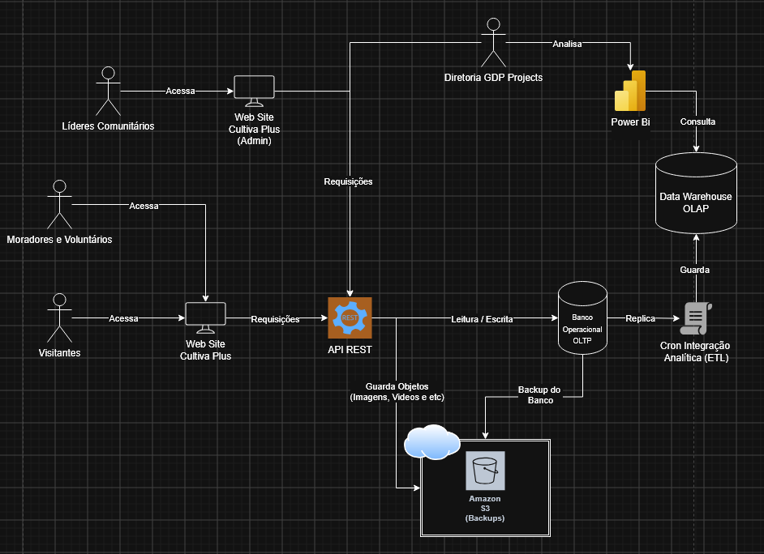

# Sistema de Hortas Comunitárias — Cultiva Plus

## Descrição do Projeto

O **Cultiva Plus** é uma plataforma prática para o gerenciamento de hortas comunitárias, conectando moradores, voluntários e responsáveis locais para planejar canteiros, acompanhar safras e organizar mutirões de forma colaborativa.

## Integrantes da Equipe — GDP Projects

* Daniel Alonso Oliveira Soares
* João Pablo Silva Pinheiro
* Erick Sales Ramos
* Antonio Gabriel Gomes Falcao do Nascimento
* Rafael Jesus Bezerra Cerqueira
* Alexandre Roque Pereira Costa
* Breno Kayan Souza de Azevedo

---

## O Que o Sistema Faz?

* **Cadastra hortas e canteiros:** Organiza os espaços físicos disponíveis em cada comunidade.
* **Controla cultivos e safras:** Registra o que foi plantado, quando e quanto foi colhido (com destino para consumo ou doação).
* **Organiza mutirões e tarefas:** Gerencia a presença dos voluntários e as atividades rotineiras (rega, adubação, capina).
* **Gera relatórios de produção:** Consolida indicadores simples para prestação de contas comunitária e acompanhamento dos resultados.

---

## Arquitetura da Solução

O diagrama abaixo ilustra a arquitetura completa e o fluxo de dados entre os usuários, aplicações, bancos operacionais e analíticos, processos de integração e infraestrutura em nuvem:

### Fluxo de Dados:
1. **Acesso dos Usuários:** Moradores, voluntários e visitantes acessam o site público; os líderes comunitários utilizam o painel administrativo.
2. **API REST:** Centraliza e processa as requisições das interfaces web, aplicando validações e regras de negócio.
3. **Banco Operacional (OLTP):** Persiste os dados cadastrais e transacionais do dia a dia (leitura e escrita em tempo real).
4. **Armazenamento em Nuvem (Amazon S3):** Recebe o armazenamento de mídias/objetos (imagens, vídeos) via API e os backups automatizados do banco operacional.
5. **Integração Analítica (Cron ETL):** Rotina programada que replica e transforma os dados operacionais para o Data Warehouse.
6. **Data Warehouse (OLAP):** Armazena o histórico consolidado de produção e participação comunitária.
7. **Power BI / Diretoria GDP Projects:** Conecta ao Data Warehouse para consultas analíticas e acompanhamento dos indicadores de desempenho.

---

## Documentação Técnica (`docs/`)

Toda a documentação do projeto está organizada em módulos diretos na pasta `docs/`:

| Módulo | O que contém? | Link |
| :--- | :--- | :--- |
| **Data Architecture** | Visão geral dos componentes, fluxo simples de dados e perfis de acesso. | [docs/data-architecture/](docs/data-architecture/README.md) |
| **Data Modeling** | Diagrama de entidades (hortas, canteiros, cultivos, colheitas), scripts SQL e fichas em papel. | [docs/data-modeling/](docs/data-modeling/README.md) |
| **Data Storage** | Onde os dados ficam guardados (PostgreSQL), regras de persistência e plano de backup. | [docs/data-storage/](docs/data-storage/README.md) |
| **Data Security** | Senhas seguras (Argon2id), tráfego criptografado (HTTPS) e controle de permissões. | [docs/data-security/](docs/data-security/README.md) |
| **Data Integration** | Integração Web ↔ API, carga noturna de relatórios e prevenção de erros. | [docs/data-integration/](docs/data-integration/README.md) |
| **Guia de Apresentação** | Roteiro rápido e divisão de falas da equipe para a banca avaliadora. | [docs/guia-apresentacao-equipe.md](docs/guia-apresentacao-equipe.md) |
