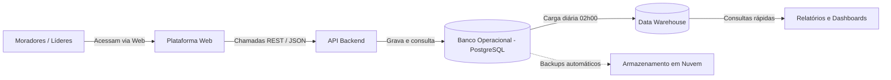

# Data Architecture (Arquitetura de Dados)

A arquitetura do **Cultiva Plus** foi desenhada para ser prática, robusta e direta, adequada a um sistema de médio porte para gestão de hortas comunitárias.

---

## 1. Visão Geral dos Componentes

O sistema é dividido em **4 componentes principais** e **2 serviços de apoio**:

1. **Plataforma Web (Front-end):** Interface web simples e responsiva para moradores, voluntários e líderes comunitários.
2. **API Backend:** Centraliza a lógica de negócio, autenticação e validações antes de gravar no banco.
3. **Banco Operacional (PostgreSQL):** Banco principal para cadastros, canteiros, cultivos, colheitas e mutirões em tempo real.
4. **Data Warehouse (Analítico):** Banco analítico separado para armazenar o histórico de safras e gerar relatórios sem pesar o banco do dia a dia.
5. **Serviços de Apoio:**
   * **Nuvem / Object Storage:** Armazenamento seguro de backups semanais e fotos das fichas físicas.
   * **Painéis de BI:** Dashboards simples com indicadores de produção e voluntariado.

---

## 2. Fluxo de Dados

---

## 3. Banco Operacional (OLTP) vs. Data Warehouse (OLAP)

Para não misturar as coisas e manter o sistema rápido, separamos o dia a dia dos relatórios:

| Critério | Banco Operacional (OLTP) | Data Warehouse (OLAP) |
| :--- | :--- | :--- |
| **Objetivo** | Atender os cliques do usuário em tempo real. | Guardar histórico e gerar gráficos/relatórios. |
| **Exemplos de dados** | Cadastrar membro, salvar colheita, marcar presença. | Total colhido por safra, evolução mensal de hortas. |
| **Velocidade** | Gravações e leituras instantâneas. | Consultas que somam meses ou anos de histórico. |
| **Dados Pessoais** | Armazena contatos (e-mail, telefone). | **Sem dados pessoais** (apenas números e IDs anônimos). |

---

## 4. Quem Pode Acessar o Quê (Perfis de Usuário)

* **Administrador Geral:** Visão total do sistema, aprova novas hortas e gerencia permissões.
* **Líder da Horta:** Gerencia os canteiros, mutirões, plantios e tarefas **da sua própria horta**.
* **Voluntário / Membro:** Visualiza sua horta, confirma presença em mutirões e conclui suas tarefas.
* **Visitante:** Apenas visualiza o mapa público com as hortas disponíveis e solicita entrada.

---

## 5. Por que essa arquitetura faz sentido?

* **Simples de manter:** Usa uma única tecnologia de banco de dados (PostgreSQL) para operacional e analítico.
* **Segura:** Ninguém acessa o banco direto; tudo passa pelas regras da API.
* **Econômica:** Roda com poucos recursos em nuvem, ideal para a realidade comunitária.
