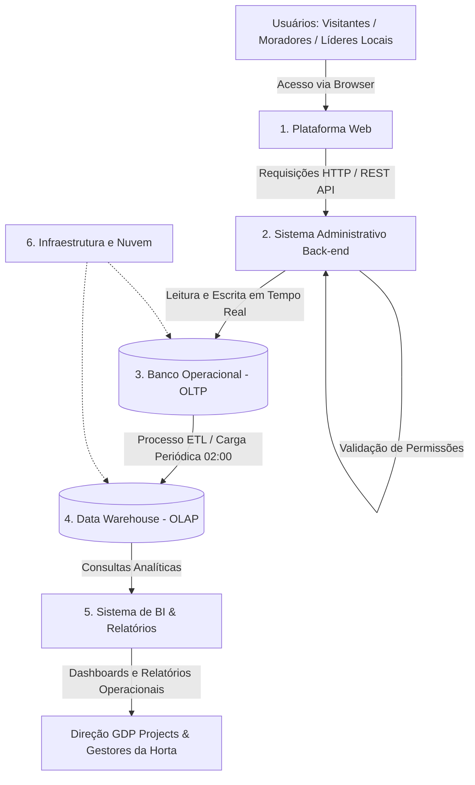

# Data Architecture (Arquitetura de Dados)

Esta seção apresenta a visão macro do sistema **Cultiva Plus**, o fluxo das informações, a divisão de responsabilidades entre os bancos transacional e analítico e a matriz de perfis e permissões.

---

## 1. Mapeamento dos Sistemas (Componentes da Arquitetura)

Para resolver a descentralização das informações e estruturar a gestão colaborativa das hortas comunitárias, a arquitetura do **Cultiva Plus** é composta por 6 sistemas:

1. **Plataforma Web (Front-end):** Interface responsiva para moradores, líderes comunitários, gestores e visitantes.
2. **Sistema Administrativo (Back-end / API):** Camada de serviços responsável pelas regras de negócio e controle da Matriz de Perfis e Permissões.
3. **Banco de Dados Operacional (OLTP):** Banco relacional para armazenamento de dados dinâmicos em tempo real (cadastros, canteiros, presença em mutirões e tarefas).
4. **Data Warehouse (OLAP):** Repositório analítico para consolidação do histórico de safras, uso de espaços e engajamento comunitário.
5. **Sistema de BI & Relatórios:** Módulo para geração de dashboards e relatórios operacionais para a GDP Projects e líderes locais.
6. **Infraestrutura e Nuvem:** Provedores de hospedagem web, agendador de tarefas, manutenção e suporte para integração com APIs externas.

---

## 2. Desenho do Fluxo de Dados

O fluxo a seguir mapeia a circulação da informação entre os componentes do sistema:

---

## 3. Transacional (OLTP) vs. Analítico (OLAP)

A separação funcional entre os bancos transacional e analítico atende às diferentes demandas operacionais e estratégicas da plataforma:

| Critério | Banco Operacional (OLTP) | Data Warehouse (OLAP) |
| :--- | :--- | :--- |
| **Escopo Principal** | Operações rotineiras da plataforma em tempo real. | Análise histórica e consolidação centralizada de informações. |
| **Responsabilidade no Sistema** | Processar cadastros, registrar presenças em mutirões, atualizar status de tarefas e aplicar permissões. | Armazenar histórico de safras, mensurar a evolução do uso dos espaços e apoiar o planejamento de novos cultivos. |
| **Perfil das Operações** | Transações simultâneas rápidas de leitura e escrita com pequeno volume por operação. | Consultas analíticas pesadas, agregações de dados e relatórios consolidados. |
| **Público-Alvo Direto** | Moradores, Líderes Locais, Visitantes e a API do sistema. | Direção Executiva e Gestores de Produtos/Projetos da GDP Projects e Líderes Comunitários. |

---

## 4. Matriz de Perfis e Permissões

* **Gestor de Projetos / Administrador Geral (GDP Projects / Responsável pela Horta):**
  * **Escopo de Acesso:** Controle total e centralizado.
  * **Ações Permitidas:** Aprovação de novos membros, concessão e revogação de permissões, gerenciamento e exclusão de hortas/canteiros, visualização de relatórios operacionais completos e logs de auditoria do sistema.

* **Responsável pela Horta (Líder Comunitário Local):**
  * **Escopo de Acesso:** Restrito à(s) horta(s) sob sua gestão.
  * **Ações Permitidas:** Cadastro de canteiros/cultivos, atribuição de tarefas a membros, atualização do status das atividades e moderação da comunicação local.

* **Membro Participante / Morador:**
  * **Escopo de Acesso:** Consulta e registro operacional básico.
  * **Ações Permitidas:** Visualização de hortas públicas/locais, confirmação de presença em mutirões, registro de tarefas concluídas e leitura de dicas de cultivo.

* **Visitante (Não autenticado):**
  * **Escopo de Acesso:** Somente leitura pública.
  * **Ações Permitidas:** Visualização do mapa geral das hortas ativas, objetivos do projeto e página de cadastro/solicitação de entrada.

---

## 5. Contribuição da Data Architecture para o Negócio

A Data Architecture define como os sistemas do Cultiva Plus se comunicam e como as informações circulam entre eles.
A utilização de uma plataforma web integrada a uma API e a um banco de dados operacional permite centralizar as informações, reduzir inconsistências e facilitar o acesso aos registros.

Além disso, a arquitetura estabelece mecanismos de validação e controle de permissões, garantindo que cada participante tenha acesso apenas às funcionalidades e informações autorizadas. Essa organização contribui para a eficiência operacional, a segurança dos dados e a possibilidade de expansão contínua da plataforma, viabilizando o apoio à tomada de decisão através de BI e alinhando-se aos objetivos estratégicos da **GDP Projects**.
