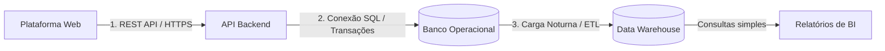

# Data Integration (Integração de Dados)

A integração do **Cultiva Plus** conecta a interface com o banco em tempo real e alimenta os relatórios diários de forma leve e prática.

---

## 1. As 3 Integrações do Sistema

1. **Web ↔ API (Tempo Real):** O voluntário usa o navegador no celular ou computador; as ações (ex.: salvar colheita, confirmar presença) chegam na API em formato JSON via HTTPS.
2. **API ↔ Banco Operacional (Transacional):** A API valida as permissões e grava os dados nas tabelas do PostgreSQL com integridade imediata.
3. **Banco Operacional ➔ Data Warehouse (Lote Noturno):** Todo dia às 02h00, uma rotina simples copia o que mudou para o banco analítico, **removendo nomes e contatos pessoais**, deixando apenas os números para os gráficos.

---

## 2. Exemplo Prático: Registrando uma Colheita

Quando um líder cadastra uma colheita na horta:

1. **Na Web:** Preenche a espécie, a quantidade colhida (ex.: 10 kg de alface) e clica em salvar. O botão é desativado na hora para evitar clique duplo.
2. **Na API:** A API recebe os dados via `POST /cultivos/3/colheitas`, confere se o líder realmente pertence àquela horta e abre uma transação no banco.
3. **No Banco Operacional:** O registro é gravado e recebe a data/hora atual (`atualizado_em`).
4. **Na Madrugada (02h00):** O processo de carga pega a colheita, soma a produção do mês e envia para o Data Warehouse.
5. **No Painel:** O gráfico da horta amanhece atualizado mostrando o rendimento da safra.

---

## 3. Como Evitamos Erros e Falhas?

* **E se o voluntário clicar duas vezes no botão de salvar?** A interface desativa o botão no primeiro clique e a API usa uma chave única (`Idempotency-Key`) para ignorar requisições repetidas.
* **E se a internet cair durante o envio?** A conexão falha antes de completar a transação; nada fica pela metade ou corrompido no banco.
* **E se a carga noturna falhar?** O processo simplesmente é cancelado e tenta de novo na janela seguinte. Os painéis continuam exibindo normalmente os dados do dia anterior.
* **E se o processo rodar mais de uma vez?** Usamos o comando *Upsert* (`ON CONFLICT DO UPDATE`), que atualiza a linha em vez de duplicar.
