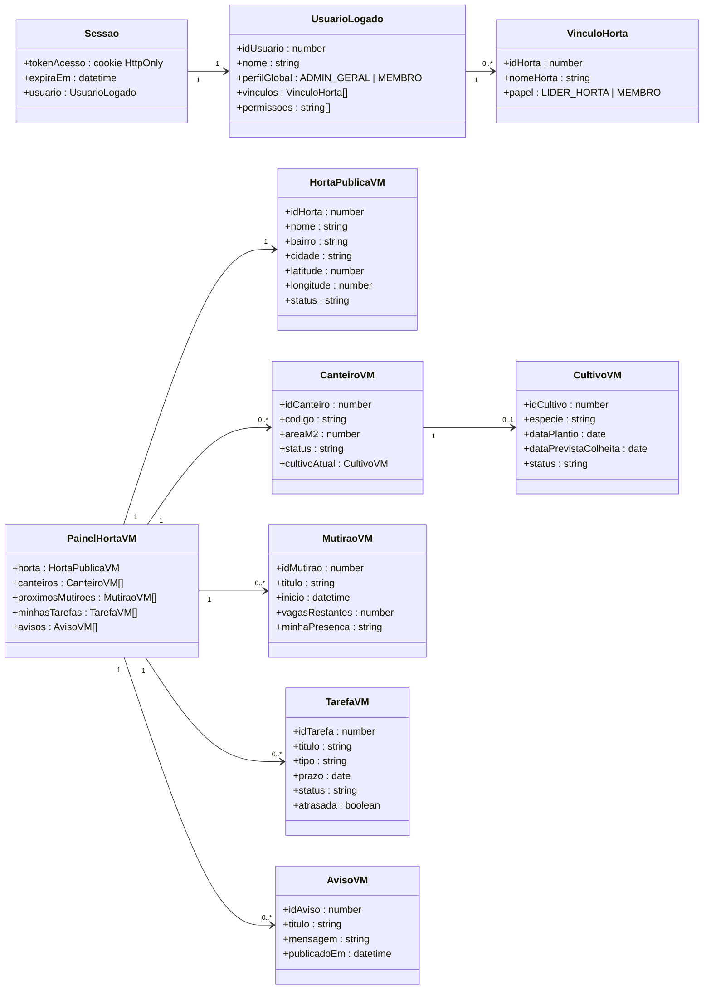
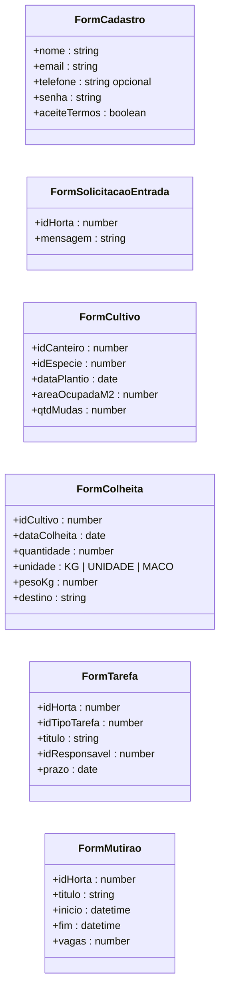

# 1. Plataforma Web (Front-end)

A Plataforma Web é a interface responsiva utilizada por moradores, líderes comunitários, voluntários e visitantes para acessar o Cultiva Plus. Como o front-end não possui banco de dados próprio, sua modelagem define **quais estruturas de dados trafegam e são manipuladas na tela**: a sessão de autenticação, os modelos de exibição (*view models*) e os formulários enviados à API.

---

## 1.1 Modelo lógico — sessão e telas

As principais estruturas manipuladas no front-end são:
* **`Sessao`:** Mantém o cookie `HttpOnly` com token de acesso seguro, data de expiração e dados do `UsuarioLogado`.
* **`UsuarioLogado`:** Identificador do usuário, nome, perfil global (`ADMIN_GERAL` ou `MEMBRO`), vínculos com hortas e permissões.
* **`VinculoHorta`:** Relaciona o usuário a uma horta específica com seu respectivo papel (`LIDER_HORTA` ou `MEMBRO`).
* **`HortaPublicaVM`:** Dados públicos da horta para localização e consulta (id, nome, bairro, cidade, coordenadas e status).
* **`PainelHortaVM`:** Agrupador da tela principal da horta, contendo canteiros, próximos mutirões, tarefas do usuário e avisos.
* **`CanteiroVM` e `CultivoVM`:** Código do canteiro, área em m², status e informações do cultivo ativo (espécie, plantio, previsão).
* **`MutiraoVM` e `TarefaVM`:** Detalhes de eventos comunitários (vagas, presença) e tarefas atribuídas com prazos e status.

## 1.2 Modelo lógico — formulários (dados que a Web envia)

A plataforma envia dados para a API estruturados nos seguintes formulários:
* **`FormCadastro`:** Dados para novo cadastro (nome, e-mail, telefone opcional, senha e aceite dos termos).
* **`FormSolicitacaoEntrada`:** Pedido de ingresso do membro em uma horta específica.
* **`FormCultivo`:** Abertura de safra em canteiro (espécie, data de plantio, área ocupada em m² e quantidade de mudas).
* **`FormColheita`:** Lançamento de produção (safra, data, quantidade, unidade, peso em kg e destino da colheita).
* **`FormTarefa`:** Cadastro de atividades para voluntários (horta, tipo da tarefa, título, responsável e prazo).
* **`FormMutirao`:** Agendamento de mutirão coletivo (título, data/hora de início e fim, número de vagas).

## 1.3 Onde cada dado da Web fica e para onde vai

| Dado | Onde fica no navegador | Tempo de vida | Vai para (via API) |
|---|---|---|---|
| Token de sessão | Cookie `HttpOnly` + `Secure` (JavaScript não lê) | Até expirar / logout | — (só autentica) |
| `UsuarioLogado`, `VinculoHorta` | Memória da aplicação | Enquanto a aba está aberta | lido de `USUARIO`, `MEMBRO_HORTA`, `PERFIL_PERMISSAO` |
| Horta selecionada, filtros | `localStorage` (sem dado pessoal) | Até o usuário limpar | — |
| *View models* das telas | Memória (cache curto) | Recarregados a cada visita | lidos do OLTP via API |
| Formulários | Memória até o envio | Descartados após salvar | gravados no OLTP via API |

**Regra:** a Web **nunca** acessa banco de dados diretamente e **nunca** grava nome, e-mail ou telefone no `localStorage`.

## 1.4 Telas × perfis × dados (coerente com a Matriz de Perfis)

| Tela | Visitante | Membro | Líder | Admin | Dados exibidos | Entidades de origem |
|---|:-:|:-:|:-:|:-:|---|---|
| Mapa das hortas | ✅ | ✅ | ✅ | ✅ | `HortaPublicaVM` (só hortas públicas e ativas) | `HORTA` |
| Cadastro / pedido de entrada | ✅ | ✅ | — | — | `FormCadastro`, `FormSolicitacaoEntrada` | `USUARIO`, `SOLICITACAO_ENTRADA` |
| Painel da horta | — | ✅ | ✅ | ✅ | `PainelHortaVM` | `CANTEIRO`, `CULTIVO`, `MUTIRAO`, `TAREFA`, `AVISO` |
| Confirmar presença | — | ✅ | ✅ | ✅ | `MutiraoVM` | `PRESENCA_MUTIRAO` |
| Concluir minha tarefa | — | ✅ | ✅ | ✅ | `TarefaVM` | `TAREFA` |
| Gestão de canteiros e cultivos | — | — | ✅ | ✅ | `FormCultivo`, `FormColheita` | `CANTEIRO`, `CULTIVO`, `COLHEITA` |
| Atribuir tarefas / agendar mutirão | — | — | ✅ | ✅ | `FormTarefa`, `FormMutirao` | `TAREFA`, `MUTIRAO` |
| Aprovar membros / moderar avisos | — | — | ✅ (própria horta) | ✅ | lista de solicitações e avisos | `SOLICITACAO_ENTRADA`, `AVISO` |
| Dicas de cultivo | — | ✅ | ✅ | ✅ | título e conteúdo | `DICA_CULTIVO`, `ESPECIE` |
