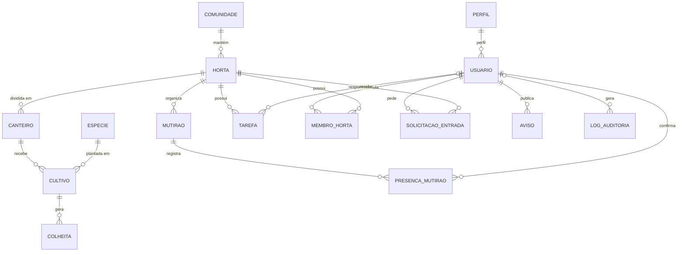

# 3. Banco de Dados Operacional (OLTP)

O banco de dados operacional (`cultiva_oltp`) gerencia as informações do dia a dia do Cultiva Plus em tempo real. Ele utiliza **PostgreSQL 16** e é estruturado em **3ª Forma Normal (3FN)** para garantir que cada dado fique em um único lugar, sem repetições nem inconsistências.

---

## 3.1 Visão Geral do Modelo

As **19 tabelas** do banco são agrupadas em 4 domínios práticos:

| Domínio | Entidades | Função |
| :--- | :--- | :--- |
| **Acesso e Pessoas** | `USUARIO`, `PERFIL`, `PERMISSAO`, `MEMBRO_HORTA`, `SOLICITACAO_ENTRADA` | Controla cadastros, login e quem é líder ou membro em cada horta. |
| **Espaços e Cultivos** | `COMUNIDADE`, `HORTA`, `CANTEIRO`, `ESPECIE`, `CULTIVO`, `COLHEITA` | Registra a horta física, canteiros, plantas, plantios e o peso colhido. |
| **Atividades** | `MUTIRAO`, `PRESENCA_MUTIRAO`, `TIPO_TAREFA`, `TAREFA` | Organiza eventos coletivos de mutirão e tarefas atribuídas a membros. |
| **Apoio e Controle** | `AVISO`, `DICA_CULTIVO`, `LOG_AUDITORIA` | Mural de notícias, dicas de horta e rastreamento de ações sensíveis. |

---

## 3.2 Principais Tabelas de Negócio

### 1. Espaços e Plantio
* **`horta`:** Dados da horta (nome, bairro, área total em m², status).
* **`canteiro`:** Subdivisões da horta (ex.: "Canteiro C-01", área em m²).
* **`especie`:** Catálogo de culturas (nome comum, científico e dias médios até colher).
* **`cultivo`:** Registro do plantio em um canteiro (data de início, área ocupada em m², status).
* **`colheita`:** Registro da produção (data, quantidade colhida, peso em kg e destino: consumo, doação ou feira).

### 2. Pessoas e Comunidade
* **`usuario`:** Dados de login (nome, e-mail único, telefone, senha em hash e status).
* **`membro_horta`:** Vínculo de um usuário com uma horta específica e seu papel (`LIDER_HORTA` ou `MEMBRO`).
* **`solicitacao_entrada`:** Pedido de novos membros para ingressar em uma horta, sujeito a aprovação do líder.

### 3. Mutirões e Tarefas
* **`mutirao`:** Evento de trabalho comunitário com data, local, objetivo e limite de vagas.
* **`presenca_mutirao`:** Confirmação de presença e registro de horas voluntárias trabalhadas.
* **`tarefa`:** Atividade rotineira (ex.: regar, capinar) com prazo, status e responsável atribuído.

---

## 3.3 Regras de Integridade Práticas

Para manter o banco seguro e consistente:
1. **Sem dados órfãos:** Chaves estrangeiras (`FOREIGN KEY`) impedem colheitas sem cultivo ou canteiros sem horta.
2. **Sem duplicatas:** Restrições `UNIQUE` impedem mesmo e-mail duas vezes, canteiros com mesmo código na mesma horta ou confirmação repetida no mesmo mutirão.
3. **Validações numéricas:** Restrições `CHECK` impedem valores negativos (ex.: peso da colheita > 0) e datas inconsistentes (término anterior ao início).
4. **Marca d'água:** O campo `atualizado_em` é atualizado automaticamente em alterações, permitindo que a sincronização para relatórios saiba exatamente o que mudou.
