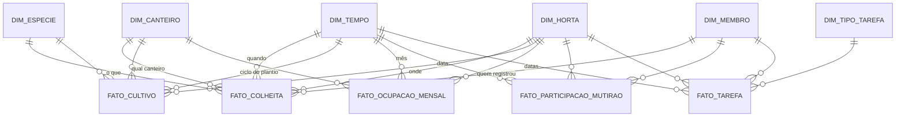

# 4. Data Warehouse (OLAP)

O Data Warehouse (`cultiva_dw`) consolida o histórico do Cultiva Plus em um banco analítico separado. Isso evita que relatórios pesados e agregações históricas deixem a navegação dos moradores lenta no banco do dia a dia.

---

## 4.1 Estrutura em Esquema Estrela

O modelo analítico utiliza o **Esquema Estrela**:
* **Tabelas Fato:** Armazenam as métricas numéricas das atividades (quilos colhidos, horas trabalhadas, áreas ocupadas).
* **Tabelas Dimensão:** Armazenam o contexto para filtragem e agrupamento (quando aconteceu, qual horta, qual espécie, quem participou).

---

## 4.2 As 5 Tabelas Fato

1. **`fato_colheita`:** Histórico de cada colheita realizada (peso em kg, quantidade de maços, destino da produção e dias decorridos desde o plantio).
2. **`fato_cultivo`:** Registro do ciclo das safras (duração prevista vs. real, se houve perda e total colhido).
3. **`fato_ocupacao_mensal`:** Percentual e metros quadrados de cada canteiro que estavam efetivamente ocupados com plantios em cada mês.
4. **`fato_participacao_mutirao`:** Engajamento voluntário nos eventos comunitários (confirmações, presenças reais e soma de horas dedicadas).
5. **`fato_tarefa`:** Produtividade das tarefas da horta (atividades concluídas, no prazo ou atrasadas).

---

## 4.3 As 6 Tabelas Dimensão

* **`dim_tempo`:** Calendário com ano, mês, dia, trimestre e **estação do ano** (relevante para agricultura urbana).
* **`dim_horta`:** Histórico das hortas com versionamento (SCD Tipo 2) para preservar como a horta era na época de cada colheita.
* **`dim_canteiro`:** Características físicas dos canteiros.
* **`dim_especie`:** Informações agronômicas das espécies de plantas.
* **`dim_membro`:** Identificador analítico dos voluntários (**sem nome, e-mail ou telefone**, garantindo privacidade LGPD).
* **`dim_tipo_tarefa`:** Classificação das tarefas (rega, adubação, colheita, manutenção).

---

## 4.4 Como Funciona a Carga Diária (ETL)

* **Horário:** Roda automaticamente todo dia às **02h00** da madrugada.
* **Incremental:** Lê do banco operacional apenas os registros alterados desde a última execução, usando a coluna `atualizado_em`.
* **Sem duplicações:** Utiliza comandos *Upsert* (`ON CONFLICT DO UPDATE`), garantindo que reexecuções da carga apenas atualizem os dados sem duplicar linhas.
