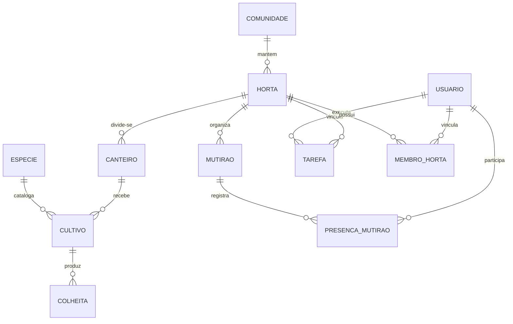
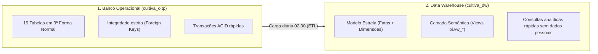

# Data Modeling (Modelagem de Dados)

O módulo de **Data Modeling** é o coração técnico do **Cultiva Plus**. Ele detalha como cada informação das hortas comunitárias é estruturada, relacionada e armazenada, garantindo integridade transacional no dia a dia e simplicidade na geração de relatórios de produção.

---

## 1. Mapa Conceitual do Domínio (Entidades Centrais)

Para atender a um sistema de médio porte de forma robusta e sem redundâncias, o Cultiva Plus organiza seus dados em torno do ciclo produtivo das hortas:

### O que cada entidade representa:
* **HORTA & COMUNIDADE:** O espaço físico mantido por uma associação de moradores ou escola.
* **CANTEIRO:** Subdivisão física identificada (ex.: Canteiro 01, área de 12 m²).
* **ESPECIE:** Catálogo de culturas (ex.: Alface, Coentro, Cenoura, Manjericão) com ciclo estimado de colheita.
* **CULTIVO (Safra):** O plantio ativo em um canteiro, registrando data de semeadura e área ocupada.
* **COLHEITA:** O resultado da produção (peso em kg ou maços) e o destino (consumo comunitário, doação ou feira de troca).
* **MUTIRÃO & PRESENÇA:** Eventos coletivos de trabalho voluntário e o controle das horas dedicadas.
* **TAREFA:** Atividades pontuais distribuídas aos voluntários (ex.: rega diária, adubação orgânica, capina).
* **USUÁRIO & MEMBRO_HORTA:** Moradores e líderes cadastrados, controlados por papéis e permissões seguras.

---

## 2. A Modelagem nos Dois Ambientes: Operacional vs. Analítico

Seguindo as melhores práticas para sistemas de médio porte, a modelagem foi dividida em duas visões complementares:

1. **Modelo Transacional Normalizado (OLTP - 3FN):**
   * Focado em **evitar duplicidade** e garantir que nenhuma colheita seja salva sem cultivo válido ou que um canteiro tenha área extrapolada.
   * Total de **19 tabelas** (12 de negócio + 7 de apoio: permissões, auditoria e avisos).
2. **Modelo Dimensional Analítico (OLAP - Esquema Estrela):**
   * Focado em **facilitar consultas de relatórios** para líderes e gestores da GDP Projects.
   * Composto por **5 tabelas fato** (`fato_colheita`, `fato_cultivo`, `fato_ocupacao_mensal`, `fato_participacao_mutirao`, `fato_tarefa`) conectadas a **6 dimensões** (`dim_tempo`, `dim_horta`, `dim_canteiro`, `dim_especie`, `dim_membro`, `dim_tipo_tarefa`).

---

## 3. Modelagem Fora do Digital: Gestão Documental Física

Reconhecendo a realidade das hortas comunitárias, onde nem sempre há conectividade à internet no campo, a modelagem se estende ao meio analógico:
* **Ficha de Canteiro e Participação em Mutirões:** Formulário padronizado em papel impresso, arquivado em armário de aço na sede da horta.
* **Sincronização:** Mensalmente, o líder local digita os registros das fichas na plataforma web e envia a foto digitalizada para a nuvem.

---

## 4. Estrutura Detalhada dos Documentos

A documentação detalhada de cada camada está dividida nos seguintes arquivos:

| Documento | Foco da Modelagem |
| :--- | :--- |
| [01-plataforma-web.md](01-plataforma-web.md) | **Interface & Formulários:** View Models de tela, dados de sessão e validações no cliente. |
| [02-sistema-administrativo-api.md](02-sistema-administrativo-api.md) | **API & Negócio:** DTOs, regras de permissão por horta e transações seguras. |
| [03-banco-operacional-oltp.md](03-banco-operacional-oltp.md) | **Banco Operacional:** DDL das 19 tabelas relacionais em 3FN, chaves primárias e regras `CHECK`. |
| [04-data-warehouse-olap.md](04-data-warehouse-olap.md) | **Data Warehouse:** Esquema estrela, surrogate keys, histórico SCD Tipo 2 e lógica de extração. |
| [05-bi-relatorios.md](05-bi-relatorios.md) | **BI & Indicadores:** Views semânticas (`bi.vw_*`), catálogo de KPIs e restrição de acesso por horta. |
| [06-infraestrutura-nuvem.md](06-infraestrutura-nuvem.md) | **Infraestrutura:** Hospedagem dos bancos, usuários técnicos (`api_app`, `etl_leitor`) e agendamento. |
| [modelo-gestao-documental-fisica.md](modelo-gestao-documental-fisica.md) | **Gestão Física:** Fichas em papel, código de identificação analógico e arquivo comunitário. |

---

## 5. Scripts SQL Disponíveis (`sql/`)

Os scripts SQL prontos e testados para PostgreSQL 16 estão na subpasta `sql/`:

* [`01_oltp_schema.sql`](sql/01_oltp_schema.sql): Criação do banco operacional `cultiva_oltp` e tabelas em 3FN.
* [`02_oltp_dados_exemplo.sql`](sql/02_oltp_dados_exemplo.sql): Dados fictícios de teste (hortas, canteiros, safras e mutirões).
* [`03_dw_schema.sql`](sql/03_dw_schema.sql): Criação do banco `cultiva_dw` com staging e esquema estrela.
* [`04_etl_oltp_para_dw.sql`](sql/04_etl_oltp_para_dw.sql): Rotina de sincronização incremental.
* [`05_bi_camada_semantica.sql`](sql/05_bi_camada_semantica.sql): Views analíticas para dashboards.
* [`06_consultas_exemplo.sql`](sql/06_consultas_exemplo.sql): Consultas prontas respondendo a dúvidas de produção.
