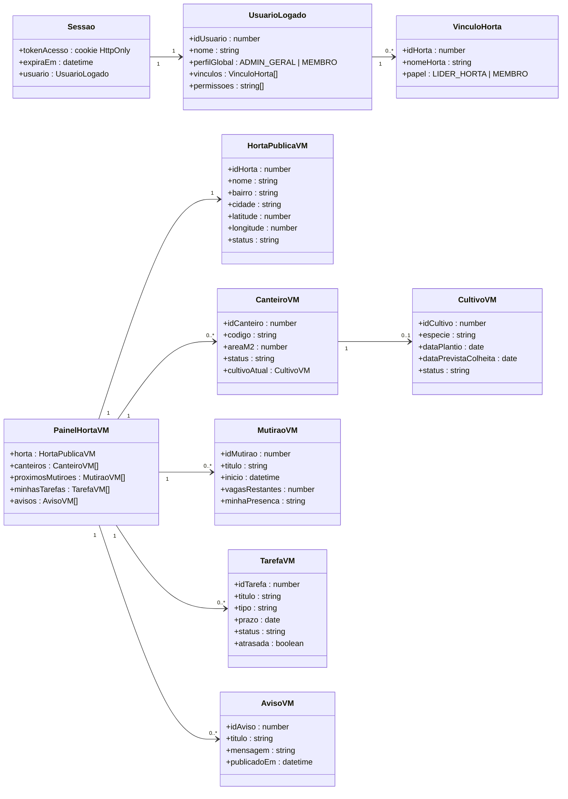
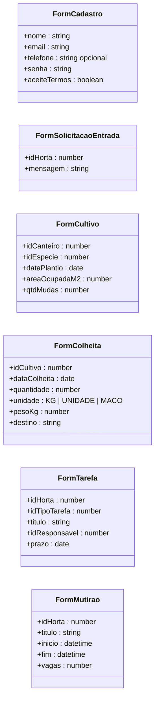

# 1. Plataforma Web (Front-end)

> **Sistema da Entrega 1:** Plataforma Web (Front-end)
> **Responsabilidade:** interface responsiva para visitantes, moradores, líderes comunitários e gestores.

Como a Plataforma Web não tem banco, o seu modelo lógico descreve **quais dados ela manipula**: a sessão do usuário, os *view models* de cada tela e os formulários que enviam dados para a API.

---

## 1.1 Modelo lógico — sessão e telas

## 1.2 Modelo lógico — formulários (dados que a Web envia)

## 1.3 Onde cada dado da Web fica e para onde vai

| Dado | Onde fica no navegador | Tempo de vida | Vai para (via API) |
|---|---|---|---|
| Token de sessão | Cookie `HttpOnly` + `Secure` (JavaScript não lê) | Até expirar / logout | — (só autentica) |
| `UsuarioLogado`, `VinculoHorta` | Memória da aplicação | Enquanto a aba está aberta | lido de `USUARIO`, `MEMBRO_HORTA`, `PERFIL_PERMISSAO` |
| Horta selecionada, filtros | `localStorage` (sem dado pessoal) | Até o usuário limpar | — |
| *View models* das telas | Memória (cache curto) | Recarregados a cada visita | lidos do OLTP via API |
| Formulários | Memória até o envio | Descartados após salvar | gravados no OLTP via API |

**Regra:** a Web **nunca** acessa banco de dados diretamente e **nunca** grava nome, e-mail ou telefone no `localStorage`.

## 1.4 Telas × perfis × dados (coerente com a Matriz de Perfis)

| Tela | Visitante | Membro | Líder | Admin | Dados exibidos | Entidades de origem |
|---|:-:|:-:|:-:|:-:|---|---|
| Mapa das hortas | ✅ | ✅ | ✅ | ✅ | `HortaPublicaVM` (só hortas públicas e ativas) | `HORTA` |
| Cadastro / pedido de entrada | ✅ | ✅ | — | — | `FormCadastro`, `FormSolicitacaoEntrada` | `USUARIO`, `SOLICITACAO_ENTRADA` |
| Painel da horta | — | ✅ | ✅ | ✅ | `PainelHortaVM` | `CANTEIRO`, `CULTIVO`, `MUTIRAO`, `TAREFA`, `AVISO` |
| Confirmar presença | — | ✅ | ✅ | ✅ | `MutiraoVM` | `PRESENCA_MUTIRAO` |
| Concluir minha tarefa | — | ✅ | ✅ | ✅ | `TarefaVM` | `TAREFA` |
| Gestão de canteiros e cultivos | — | — | ✅ | ✅ | `FormCultivo`, `FormColheita` | `CANTEIRO`, `CULTIVO`, `COLHEITA` |
| Atribuir tarefas / agendar mutirão | — | — | ✅ | ✅ | `FormTarefa`, `FormMutirao` | `TAREFA`, `MUTIRAO` |
| Aprovar membros / moderar avisos | — | — | ✅ (própria horta) | ✅ | lista de solicitações e avisos | `SOLICITACAO_ENTRADA`, `AVISO` |
| Dicas de cultivo | — | ✅ | ✅ | ✅ | título e conteúdo | `DICA_CULTIVO`, `ESPECIE` |
