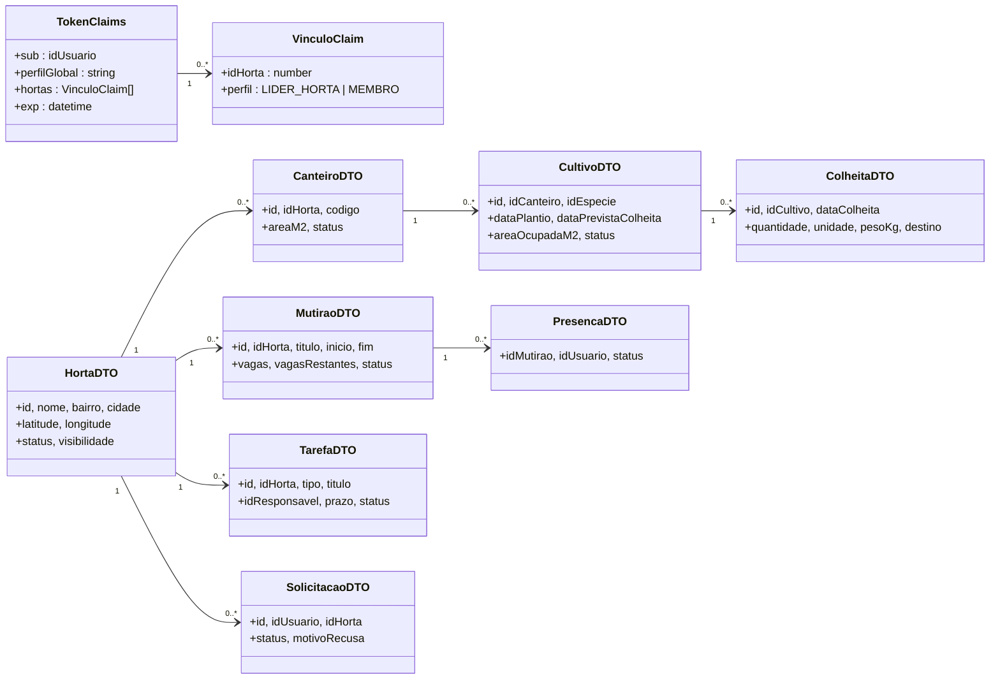
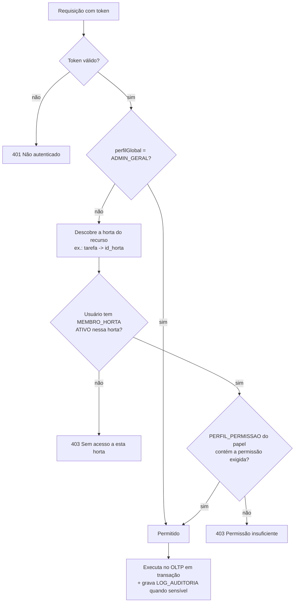
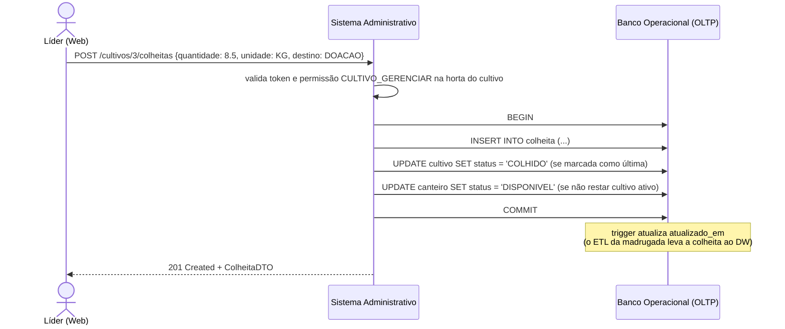

# 2. Sistema Administrativo (Back-end / API)

> **Sistema da Entrega 1:** Sistema Administrativo (Back-end / API)
> **Responsabilidade:** regras de negócio e controle da Matriz de Perfis e Permissões.
> **Armazena dados?** Não tem banco próprio: é a **única porta de entrada** do Banco Operacional. Toda leitura/escrita no OLTP passa por aqui, usando o usuário de banco `api_app`.

O modelo lógico da API descreve **os recursos que ela expõe**, **como cada recurso é gravado no OLTP** e **como a permissão é verificada**.

---

## 2.1 Modelo lógico — recursos (DTOs) e entidades do OLTP

## 2.2 Recursos × entidades × permissões

| Recurso (endpoint) | Método | Grava/lê no OLTP | Permissão exigida | Perfis |
|---|---|---|---|---|
| `/hortas/publicas` | GET | `HORTA` (só públicas e ativas, sem dados de membros) | — (público) | Visitante e todos |
| `/usuarios` | POST | `USUARIO` (status `PENDENTE`) | — (público) | Visitante |
| `/hortas/{id}/solicitacoes` | POST | `SOLICITACAO_ENTRADA` | — (autenticado) | Usuário pendente/membro |
| `/solicitacoes/{id}/aprovar` | POST | `SOLICITACAO_ENTRADA`, `MEMBRO_HORTA`, `USUARIO`, `LOG_AUDITORIA` | `MEMBRO_APROVAR` | Líder (própria horta), Admin |
| `/membros/{id}/perfil` | PUT | `MEMBRO_HORTA`, `LOG_AUDITORIA` | `PERMISSAO_GERENCIAR` | Admin |
| `/hortas` | POST/PUT/DELETE | `HORTA`, `COMUNIDADE` | `HORTA_GERENCIAR` | Admin |
| `/hortas/{id}/canteiros` | POST/PUT | `CANTEIRO` | `CANTEIRO_GERENCIAR` | Líder, Admin |
| `/canteiros/{id}/cultivos` | POST/PUT | `CULTIVO`, `CANTEIRO.status` | `CULTIVO_GERENCIAR` | Líder, Admin |
| `/cultivos/{id}/colheitas` | POST | `COLHEITA` (e `CULTIVO.status` se for a última) | `CULTIVO_GERENCIAR` | Líder, Admin |
| `/hortas/{id}/mutiroes` | POST/PUT | `MUTIRAO` | `MUTIRAO_GERENCIAR` | Líder, Admin |
| `/mutiroes/{id}/presenca` | PUT | `PRESENCA_MUTIRAO` (a do próprio usuário) | `MUTIRAO_CONFIRMAR` | Membro, Líder, Admin |
| `/hortas/{id}/tarefas` | POST | `TAREFA` | `TAREFA_ATRIBUIR` | Líder, Admin |
| `/tarefas/{id}/concluir` | POST | `TAREFA` (só se for o responsável) | `TAREFA_CONCLUIR` | Membro, Líder, Admin |
| `/hortas/{id}/avisos/{id}/moderar` | PUT | `AVISO`, `LOG_AUDITORIA` | `AVISO_MODERAR` | Líder, Admin |
| `/dicas` | GET | `DICA_CULTIVO`, `ESPECIE` | `DICA_LER` | Membro, Líder, Admin |
| `/auditoria` | GET | `LOG_AUDITORIA` | `AUDITORIA_VER` | Admin |

## 2.3 Como a permissão é verificada

As permissões **não estão escritas no código**: ficam nas tabelas `PERFIL`, `PERMISSAO` e `PERFIL_PERMISSAO` do OLTP. A API carrega essa matriz em cache e decide assim:

## 2.4 Regras de negócio que a API garante (além das restrições do banco)

| Regra | Entidades envolvidas |
|---|---|
| Não cadastrar cultivo em canteiro `INATIVO` ou `EM_DESCANSO` | `CANTEIRO`, `CULTIVO` |
| A soma de `area_ocupada_m2` dos cultivos ativos não pode passar da área do canteiro | `CANTEIRO`, `CULTIVO` |
| Ao iniciar um cultivo, o canteiro passa a `OCUPADO`; ao encerrar o último, volta a `DISPONIVEL` | `CULTIVO`, `CANTEIRO` |
| Não confirmar presença se o mutirão não tem mais vagas ou já passou | `MUTIRAO`, `PRESENCA_MUTIRAO` |
| Um membro só conclui tarefa da qual é responsável; o líder conclui qualquer tarefa da sua horta | `TAREFA`, `MEMBRO_HORTA` |
| Líder só aprova solicitações da(s) horta(s) que lidera | `SOLICITACAO_ENTRADA`, `MEMBRO_HORTA` |
| Aprovações, mudanças de perfil e moderações sempre geram `LOG_AUDITORIA` | `LOG_AUDITORIA` |
| Visitante só recebe dados públicos (nenhum dado de membro) | `HORTA` |

## 2.5 Exemplo de fluxo: registrar uma colheita

