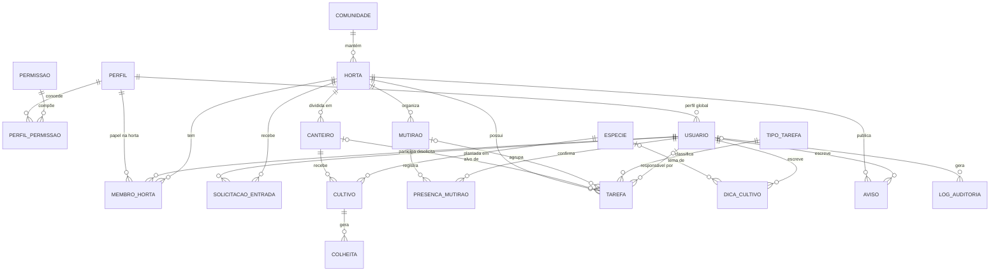
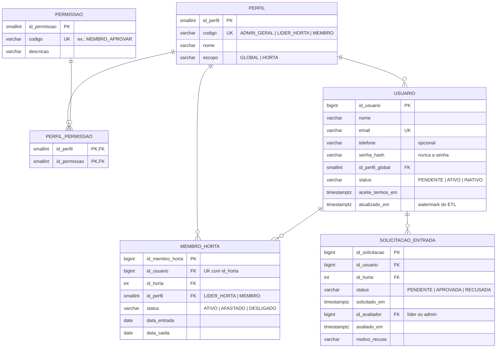
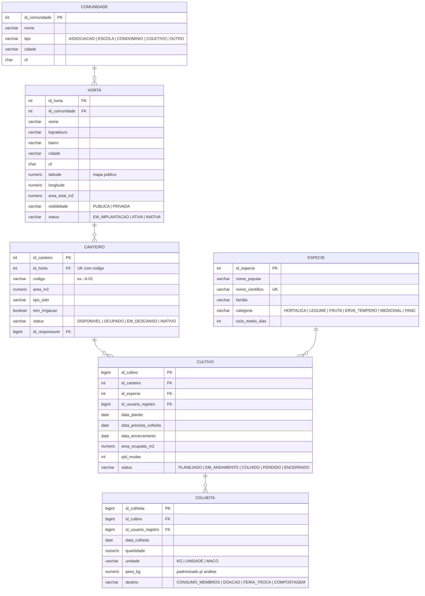
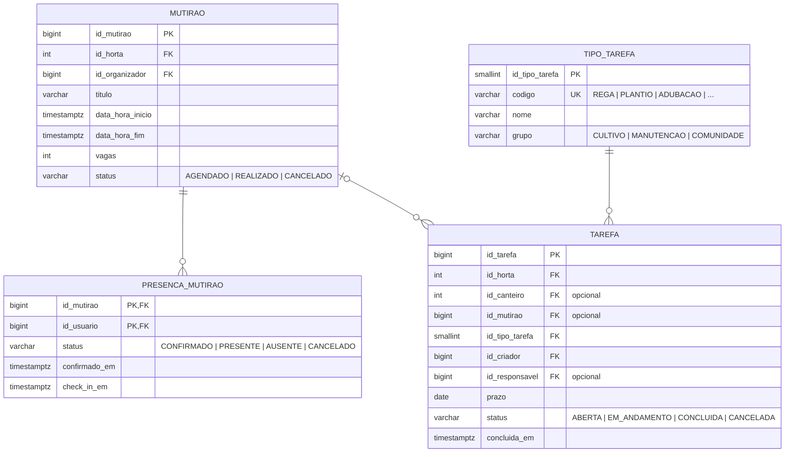
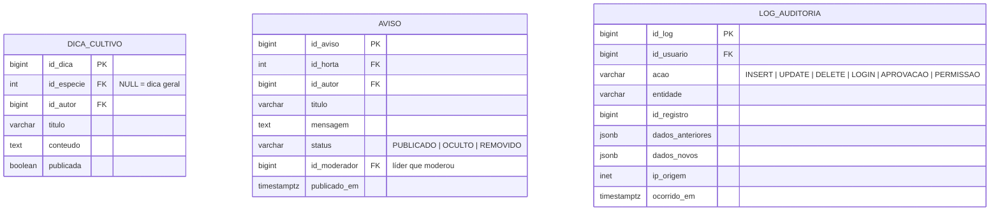

# 3. Banco de Dados Operacional (OLTP)

## 3.1 Visão geral do modelo lógico

O modelo é **relacional e normalizado (3ª Forma Normal)**, porque o foco do OLTP é gravar e alterar dados com rapidez e sem duplicidade. São **19 entidades**, organizadas em 4 domínios.

| Domínio | Entidades |
|---|---|
| **Acesso e pessoas** | `PERFIL`, `PERMISSAO`, `PERFIL_PERMISSAO`, `USUARIO`, `MEMBRO_HORTA`, `SOLICITACAO_ENTRADA` |
| **Espaços e cultivos** | `COMUNIDADE`, `HORTA`, `CANTEIRO`, `ESPECIE`, `CULTIVO`, `COLHEITA` |
| **Atividades** | `MUTIRAO`, `PRESENCA_MUTIRAO`, `TIPO_TAREFA`, `TAREFA` |
| **Conteúdo e controle** | `DICA_CULTIVO`, `AVISO`, `LOG_AUDITORIA` |

---

## 3.2 Domínio: Acesso e pessoas

Implementa a **Matriz de Perfis e Permissões** do README. Um mesmo usuário pode ser **Líder** de uma horta e **Membro** de outra; por isso o papel na horta fica em `MEMBRO_HORTA`, e não em `USUARIO`. O **Visitante** não é autenticado e não tem registro no banco.

## 3.3 Domínio: Espaços e cultivos

Uma **horta** é dividida em **canteiros**; cada plantio de uma **espécie** em um canteiro é um **cultivo** (uma safra), que gera várias **colheitas**. Essa cadeia é a base do "histórico de safras" e do "uso dos espaços" que o Data Warehouse analisa.

## 3.4 Domínio: Atividades

## 3.5 Domínio: Conteúdo e controle

---

## 3.6 Dicionário resumido das entidades

| Entidade | O que representa | Chave primária | Chaves estrangeiras | Regras importantes |
|---|---|---|---|---|
| `PERFIL` | Perfis da Matriz de Permissões | `id_perfil` | — | `codigo` único; escopo GLOBAL ou HORTA |
| `PERMISSAO` | Ação que pode ser liberada | `id_permissao` | — | `codigo` único |
| `PERFIL_PERMISSAO` | Quais permissões cada perfil tem (N:N) | (`id_perfil`, `id_permissao`) | perfil, permissão | — |
| `USUARIO` | Pessoa cadastrada | `id_usuario` | perfil global | e-mail único; senha só como hash |
| `MEMBRO_HORTA` | Vínculo usuário × horta e o papel exercido | `id_membro_horta` | usuário, horta, perfil | 1 vínculo por usuário/horta; `data_saida ≥ data_entrada` |
| `SOLICITACAO_ENTRADA` | Pedido para entrar em uma horta | `id_solicitacao` | usuário, horta, avaliador | status PENDENTE → APROVADA/RECUSADA |
| `COMUNIDADE` | Associação, escola, condomínio etc. | `id_comunidade` | — | tipo controlado por CHECK |
| `HORTA` | Horta comunitária | `id_horta` | comunidade | área > 0; visibilidade pública/privada |
| `CANTEIRO` | Espaço de cultivo dentro da horta | `id_canteiro` | horta, responsável | código único dentro da horta; área > 0 |
| `ESPECIE` | Catálogo de plantas | `id_especie` | — | nome científico único |
| `CULTIVO` | Um plantio (safra) em um canteiro | `id_cultivo` | canteiro, espécie, usuário | datas coerentes (encerramento ≥ plantio) |
| `COLHEITA` | Cada colheita de um cultivo | `id_colheita` | cultivo, usuário | quantidade > 0; peso em kg padronizado |
| `MUTIRAO` | Evento coletivo de trabalho | `id_mutirao` | horta, organizador | fim > início |
| `PRESENCA_MUTIRAO` | Confirmação/presença de um usuário (N:N) | (`id_mutirao`, `id_usuario`) | mutirão, usuário | 1 registro por pessoa por mutirão |
| `TIPO_TAREFA` | Tipos de tarefa (rega, plantio...) | `id_tipo_tarefa` | — | agrupados em CULTIVO / MANUTENÇÃO / COMUNIDADE |
| `TAREFA` | Atividade atribuída a um membro | `id_tarefa` | horta, canteiro, mutirão, tipo, criador, responsável | se CONCLUÍDA, `concluida_em` obrigatório |
| `DICA_CULTIVO` | Conhecimento compartilhado | `id_dica` | espécie, autor | — |
| `AVISO` | Comunicação local da horta | `id_aviso` | horta, autor, moderador | moderado pelo líder |
| `LOG_AUDITORIA` | Quem fez o quê e quando | `id_log` | usuário | a API só pode **inserir** (não altera nem apaga) |

### Por que está normalizado assim (3FN)

- **`COMUNIDADE` separada de `HORTA`:** uma comunidade pode manter várias hortas; o nome dela não se repete em cada horta.
- **`MEMBRO_HORTA` e `PRESENCA_MUTIRAO`:** resolvem relações muitos-para-muitos (usuário × horta, usuário × mutirão) e guardam atributos próprios do vínculo (papel, status, check-in).
- **`PERFIL_PERMISSAO`:** liberar uma permissão nova para um perfil é inserir uma linha, sem alterar código.
- **`TIPO_TAREFA` e `ESPECIE` como tabelas de referência:** evitam grafias diferentes ("Rega", "rega", "Regar") que atrapalhariam a análise depois.

---

## 3.7 Como os dados são armazenados (modelo físico)

| Decisão | Como foi implementado | Por quê |
|---|---|---|
| **SGBD** | PostgreSQL 16, banco `cultiva_oltp`, schema `oltp` | Relacional, gratuito, transações ACID, suportado pelos principais provedores de nuvem |
| **Chaves** | Chaves substitutas numéricas (`IDENTITY`) + chaves naturais com `UNIQUE` (e-mail, código do canteiro) | Joins rápidos e sem duplicidade de cadastro |
| **Domínios** | `CHECK` para status, categorias e unidades | O banco recusa valores inválidos mesmo se a API falhar |
| **Datas** | `TIMESTAMPTZ` (com fuso) para eventos; `DATE` para datas de calendário | Evita erros de fuso entre servidor e usuários |
| **Medidas** | `NUMERIC` para área (m²) e peso (kg) | Precisão exata (sem arredondamento de ponto flutuante) |
| **Controle de mudanças** | Coluna `atualizado_em` mantida por *trigger* em todas as tabelas alteráveis | É a "marca d'água" que o ETL usa para extrair só o que mudou |
| **Índices** | Nas chaves estrangeiras mais consultadas e em `atualizado_em` | Telas rápidas e extração incremental eficiente |
| **Auditoria** | `LOG_AUDITORIA` com estado anterior/novo em `JSONB` | Atende "logs de auditoria" da Matriz de Permissões |
| **Usuários do banco** | `api_app` (lê/escreve; não apaga auditoria) e `etl_leitor` (só leitura, sem dados pessoais) | Princípio do menor privilégio |
| **Privacidade (LGPD)** | Só dados pessoais mínimos (nome, e-mail, telefone opcional); senha como hash; o ETL lê `vw_extracao_usuario`, que não expõe nome/e-mail/telefone | Coerente com o README: "evitar a coleta de informações desnecessárias" |

### Exemplo: o que acontece quando um líder aprova um novo membro

Tudo em **uma única transação** feita pela API (ou tudo é gravado, ou nada é):

1. `SOLICITACAO_ENTRADA.status` → `APROVADA` (com `id_avaliador` e `avaliado_em`);
2. `INSERT` em `MEMBRO_HORTA` com perfil `MEMBRO`;
3. `USUARIO.status` → `ATIVO` (se estava `PENDENTE`);
4. `INSERT` em `LOG_AUDITORIA` (ação `APROVACAO`).
