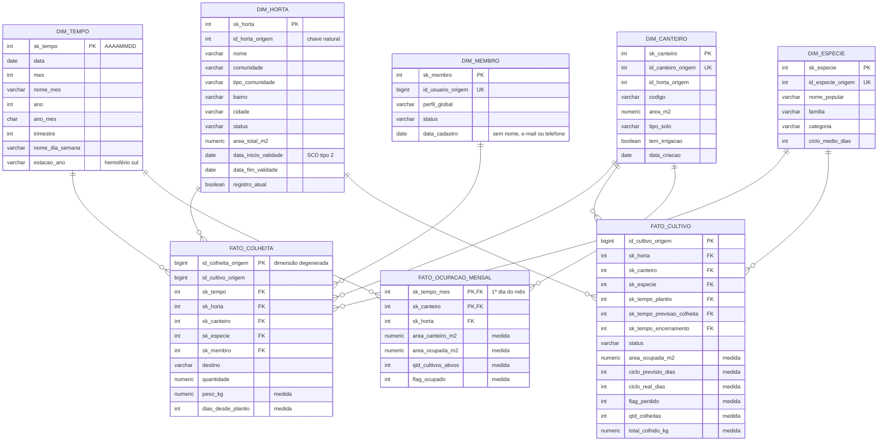
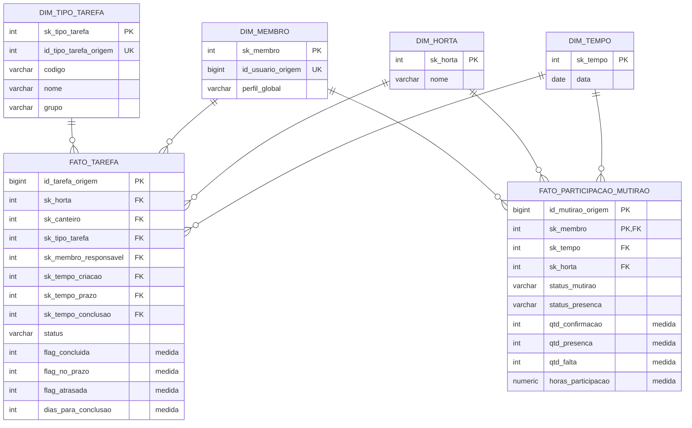
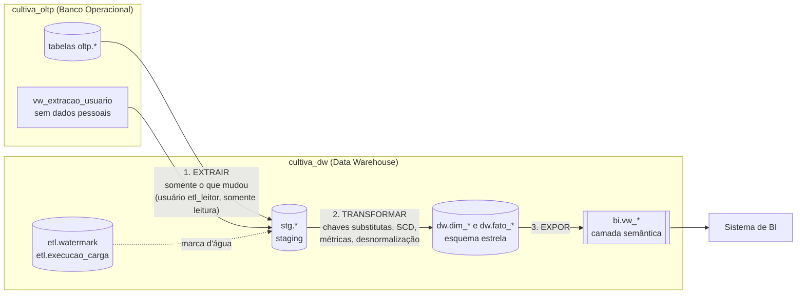

# 4. Data Warehouse (OLAP)

O DW fica em um **banco separado** (`cultiva_dw`) para que relatórios pesados nunca deixem a plataforma lenta para os moradores. O modelo é **dimensional (esquema estrela / constelação de fatos)**: tabelas **fato** guardam os números (kg, m², horas, quantidades) e tabelas **dimensão** guardam o contexto para filtrar e agrupar (quando, onde, o quê, quem).

---

## 4.1 Modelo lógico — constelação de fatos

Cinco fatos compartilham as mesmas dimensões (**dimensões conformadas**), o que permite cruzar produção, ocupação e engajamento da mesma horta no mesmo mês.

```mermaid
erDiagram
    DIM_TEMPO       ||--o{ FATO_COLHEITA             : "data da colheita"
    DIM_HORTA       ||--o{ FATO_COLHEITA             : ""
    DIM_CANTEIRO    ||--o{ FATO_COLHEITA             : ""
    DIM_ESPECIE     ||--o{ FATO_COLHEITA             : ""
    DIM_MEMBRO      ||--o{ FATO_COLHEITA             : "quem registrou"

    DIM_TEMPO       ||--o{ FATO_CULTIVO              : "plantio / previsão / encerramento"
    DIM_HORTA       ||--o{ FATO_CULTIVO              : ""
    DIM_CANTEIRO    ||--o{ FATO_CULTIVO              : ""
    DIM_ESPECIE     ||--o{ FATO_CULTIVO              : ""

    DIM_TEMPO       ||--o{ FATO_OCUPACAO_MENSAL      : "mês"
    DIM_HORTA       ||--o{ FATO_OCUPACAO_MENSAL      : ""
    DIM_CANTEIRO    ||--o{ FATO_OCUPACAO_MENSAL      : ""

    DIM_TEMPO       ||--o{ FATO_PARTICIPACAO_MUTIRAO : "data do mutirão"
    DIM_HORTA       ||--o{ FATO_PARTICIPACAO_MUTIRAO : ""
    DIM_MEMBRO      ||--o{ FATO_PARTICIPACAO_MUTIRAO : ""

    DIM_TEMPO       ||--o{ FATO_TAREFA               : "criação / prazo / conclusão"
    DIM_HORTA       ||--o{ FATO_TAREFA               : ""
    DIM_CANTEIRO    ||--o{ FATO_TAREFA               : ""
    DIM_TIPO_TAREFA ||--o{ FATO_TAREFA               : ""
    DIM_MEMBRO      ||--o{ FATO_TAREFA               : "responsavel"
```

### Estrela 1 — Produção e uso dos espaços

### Estrela 2 — Engajamento comunitário e organização das atividades

### Fatos: tipo, grão e pergunta que respondem

| Fato | Tipo | Grão (1 linha = …) | Principais medidas | Pergunta de negócio |
|---|---|---|---|---|
| `fato_colheita` | Transacional | 1 colheita registrada | `peso_kg`, `dias_desde_plantio` | Quanto cada horta produz, de quê, e para onde vai (consumo, doação, troca)? |
| `fato_cultivo` | Snapshot acumulativo (a linha é atualizada até a safra fechar) | 1 cultivo/safra | ciclo previsto × real, perda, kg total | Quais espécies rendem mais por m²? Quais têm mais perdas? |
| `fato_ocupacao_mensal` | Snapshot periódico | 1 canteiro × 1 mês | área ocupada, canteiros ocupados | Como evoluiu o uso dos espaços? Há canteiros ociosos? |
| `fato_participacao_mutirao` | Transacional | 1 membro × 1 mutirão | confirmações, presenças, faltas, horas | A comunidade está participando? Quem confirma comparece? |
| `fato_tarefa` | Snapshot acumulativo | 1 tarefa | concluída, no prazo, atrasada, dias | As atividades estão organizadas e sendo cumpridas no prazo? |

### Dimensões

| Dimensão | Histórico (SCD) | Observação |
|---|---|---|
| `dim_tempo` | Fixa (gerada de 2024 a 2030) | Inclui estação do ano do hemisfério sul — relevante para plantio |
| `dim_horta` | **Tipo 2** (cria nova versão) | Se a horta muda de status/área, as colheitas antigas continuam ligadas à versão da época |
| `dim_canteiro` | Tipo 1 (sobrescreve) | Guarda a data de criação para o cálculo de ocupação |
| `dim_especie` | Tipo 1 | Catálogo de plantas |
| `dim_membro` | Tipo 1 | **Pseudonimizada**: sem nome, e-mail ou telefone |
| `dim_tipo_tarefa` | Tipo 1 | Grupos CULTIVO / MANUTENÇÃO / COMUNIDADE |

Toda dimensão tem uma linha **`-1 = "Não informado"`** — por exemplo, uma tarefa sem responsável aponta para o membro `-1`, em vez de ficar com chave nula.

---

## 4.2 Quais dados vão para o Data Warehouse?

Somente o que serve para **análise histórica**. Dados pessoais e textos livres ficam no OLTP.

| Origem no OLTP | Vai para o DW? | Destino | Motivo |
|---|---|---|---|
| `colheita` (+ `cultivo`, `canteiro`) | ✅ Sim | `fato_colheita` | Histórico de safras / produção |
| `cultivo` | ✅ Sim | `fato_cultivo` e, derivado, `fato_ocupacao_mensal` | Desempenho das safras e uso dos espaços |
| `presenca_mutirao` + `mutirao` | ✅ Sim (sem título/descrição) | `fato_participacao_mutirao` | Engajamento comunitário |
| `tarefa` | ✅ Sim (sem título/descrição) | `fato_tarefa` | Organização das atividades |
| `horta` + `comunidade` | ✅ Sim (sem endereço, CEP e coordenadas) | `dim_horta` (desnormalizada) | Agrupar por horta, bairro, cidade, tipo de comunidade |
| `canteiro`, `especie`, `tipo_tarefa` | ✅ Sim | dimensões correspondentes | Contexto das análises |
| `usuario` | ⚠️ Parcial — só id, perfil, status e data de cadastro | `dim_membro` | Contar participação **sem identificar a pessoa** (LGPD) |
| `usuario.nome`, `email`, `telefone`, `senha_hash` | ❌ Não | — | Dado pessoal sem valor analítico |
| `perfil`, `permissao`, `perfil_permissao` | ❌ Não | — | Regras operacionais (o perfil vai como atributo de `dim_membro`) |
| `membro_horta`, `solicitacao_entrada` | ❌ Não nesta versão | — | Evolução prevista: fato de adesão (funil solicitação → aprovação) |
| `dica_cultivo`, `aviso` | ❌ Não | — | Conteúdo textual, sem métrica |
| `log_auditoria` | ❌ Não | — | É controle de segurança, fica no OLTP com retenção própria |

---

## 4.3 Como os dados saem do banco operacional? (ETL)

| Etapa | O que acontece | Onde está no código |
|---|---|---|
| **Agendamento** | Todo dia às 02:00 (fora do horário de uso) um agendador executa `CALL etl.executar_carga();` | `04_etl_oltp_para_dw.sql` (cabeçalho) |
| **Conexão** | O DW conecta no OLTP via `postgres_fdw` com o usuário **`etl_leitor`**, que só tem `SELECT` e **não enxerga nome, e-mail, telefone nem senha** | seção 1 do script |
| **1. Extração incremental** | Para cada tabela, lê só linhas com `atualizado_em` maior que a última **marca d'água** (com 10 min de sobreposição para não perder transações tardias) e grava em `stg.*` | `etl.fn_extrair` |
| **2. Transformação** | Junta tabelas (ex.: horta + comunidade), converte datas para o fuso `America/Bahia`, troca chaves do OLTP pelas chaves substitutas (`sk_*`), calcula métricas (ciclo real, atraso, horas de mutirão, área ocupada) | `etl.fn_carregar_dimensoes`, `etl.fn_carregar_fatos` |
| **3. Carga** | Dimensões: *upsert* (SCD1) ou nova versão (SCD2 em `dim_horta`). Fatos: *upsert* pela chave de origem — rodar duas vezes **não duplica** nada. `fato_ocupacao_mensal` é recalculado a partir de `fato_cultivo` | idem |
| **Controle** | Cada execução registra início, fim, status e linhas por tabela. Se algo falhar, **tudo é desfeito** e a marca d'água não avança — a próxima execução tenta de novo | `etl.executar_carga`, `etl.execucao_carga` |

**Testado:** na 1ª carga foram extraídas todas as linhas; numa 2ª execução sem mudanças, **0 linhas**; após alterar 1 presença no OLTP, a 3ª execução extraiu **apenas 1 linha** e atualizou o fato sem duplicar.

---

## 4.4 Qual é a finalidade?

Responder perguntas que o banco operacional **não deve** responder (seriam consultas pesadas sobre todo o histórico, disputando recursos com os usuários):

1. **Planejamento de cultivos:** qual espécie rende mais kg/m² e qual tem maior taxa de perda em cada estação do ano?
2. **Uso dos espaços:** qual a taxa de ocupação dos canteiros mês a mês? Há hortas com canteiros ociosos que poderiam receber novos membros?
3. **Impacto social:** quantos kg foram produzidos e quanto foi **doado**?
4. **Engajamento:** a taxa de comparecimento em mutirões está subindo ou caindo? Quantas horas de voluntariado a comunidade dedicou?
5. **Organização:** que tipo de tarefa mais atrasa? Há tarefas sem responsável?

### Resultado real com os dados de exemplo (`06_consultas_exemplo.sql`)

| Horta | Produção (kg) | % doado | Ocupação no mês | Comparecimento | Horas voluntárias | Tarefas no prazo |
|---|---:|---:|---:|---:|---:|---:|
| Horta Comunitária Jardim das Flores | 80,5 | 37,3% | 51,6% | 83,3% | 38 h | 66,7% |
| Horta Escola Raízes | 17,5 | 0,0% | 81,8% | 85,7% | 16 h | 50,0% |
| Horta Vila Verde (em implantação) | 0 | — | 0,0% | — | 0 h | — |

| Espécie | Cultivos fechados | Taxa de perda | Ciclo previsto → real | kg/m² |
|---|---:|---:|---|---:|
| Alface | 3 | 0% | 60 → 67 dias | 1,79 |
| Tomate-cereja | 1 | 0% | 90 → 127 dias | 1,54 |
| Coentro | 1 | 0% | 45 → 54 dias | 0,83 |
| Quiabo | 1 | **100%** | 70 → 81 dias | 0,00 |

Leitura: a alface é a cultura mais produtiva por m²; o quiabo foi perdido (pulgão) — sinal para o líder rever o manejo antes de replantar.
