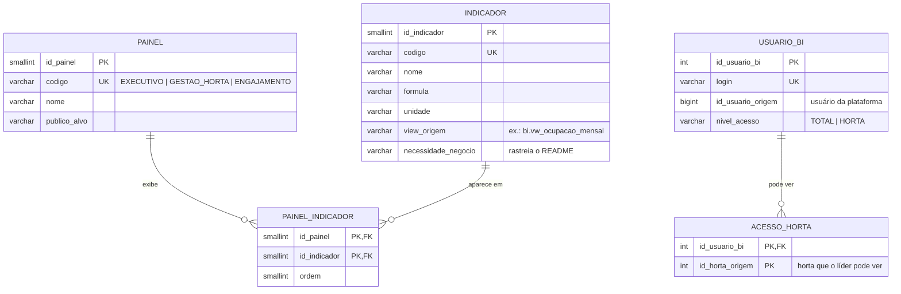
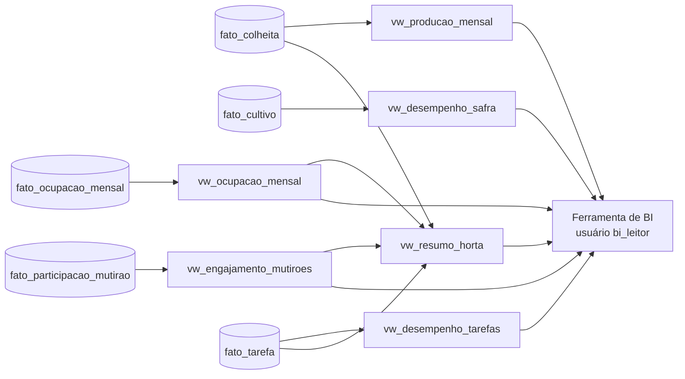

# 5. Sistema de BI & Relatórios

O BI tem dois modelos lógicos:

1. **Camada semântica** — views que traduzem o esquema estrela em linguagem de negócio (ex.: "taxa de ocupação", "% doado"). Assim, a ferramenta de BI (Metabase, Power BI, Looker Studio etc.) não precisa conhecer chaves substitutas nem regras de cálculo.
2. **Catálogo do BI** — quais painéis existem, quais indicadores cada um mostra e **quem pode ver qual horta**.

---

## 5.1 Modelo lógico do catálogo do BI



## 5.2 Camada semântica (views consumidas pelos dashboards)



| View | Grão | Colunas principais | Painel |
|---|---|---|---|
| `bi.vw_producao_mensal` | mês × horta × espécie × destino | `qtd_colheitas`, `total_kg` | Executivo, Gestão da Horta |
| `bi.vw_desempenho_safra` | espécie | `taxa_perda_pct`, `ciclo_previsto_medio_dias`, `ciclo_real_medio_dias`, `kg_por_m2` | Gestão da Horta |
| `bi.vw_ocupacao_mensal` | mês × horta | `canteiros_ocupados`, `area_ocupada_m2`, `taxa_ocupacao_pct` | Executivo, Gestão da Horta |
| `bi.vw_engajamento_mutiroes` | mês × horta | `confirmacoes`, `presencas`, `taxa_comparecimento_pct`, `horas_voluntariado` | Engajamento |
| `bi.vw_desempenho_tarefas` | mês × horta × tipo de tarefa | `concluidas_no_prazo`, `atrasadas`, `sem_responsavel`, `media_dias_conclusao` | Gestão da Horta |
| `bi.vw_resumo_horta` | horta | todos os KPIs consolidados | Executivo |

## 5.3 Indicadores (KPIs) e a necessidade de negócio que atendem

| Indicador | Fórmula | Necessidade do negócio (README) |
|---|---|---|
| Produção total (kg) | Σ `peso_kg` | Permitir o acompanhamento dos cultivos |
| % da produção doada | kg com destino DOAÇÃO ÷ kg total | Promover práticas sustentáveis e compartilhamento |
| Taxa de perda de safra | cultivos perdidos ÷ cultivos encerrados | Tornar a gestão dos cultivos mais eficiente |
| Produtividade (kg/m²) | kg colhidos ÷ área ocupada | Apoiar o planejamento de novos cultivos |
| Taxa de ocupação dos canteiros | área ocupada ÷ área dos canteiros (por mês) | Facilitar o gerenciamento dos espaços |
| Comparecimento em mutirões | presenças ÷ confirmações | Incentivar a participação da comunidade |
| Horas de voluntariado | Σ horas dos presentes | Incentivar a participação da comunidade |
| Tarefas concluídas no prazo | concluídas até o prazo ÷ concluídas | Organizar as atividades realizadas nas hortas |
| Tarefas abertas em atraso | nº de tarefas abertas com prazo vencido | Organizar as atividades realizadas nas hortas |

## 5.4 Quem vê o quê (coerente com a Matriz de Perfis)

| Perfil da plataforma | Painéis | Escopo dos dados |
|---|---|---|
| Gestor de Projetos / Administrador Geral (GDP Projects) | Executivo, Gestão da Horta, Engajamento | **Todas** as hortas (`nivel_acesso = TOTAL`) |
| Responsável pela Horta (Líder) | Gestão da Horta, Engajamento | **Somente** as hortas em `ACESSO_HORTA` |
| Membro / Morador | — (vê só informações operacionais no app) | — |
| Visitante | — | — |

O filtro por horta é aplicado com a função `bi.fn_hortas_permitidas(login)`:

```sql
-- O que o líder Carlos (Horta Jardim das Flores) enxerga
SELECT ano_mes, horta, SUM(total_kg) AS kg
  FROM bi.vw_producao_mensal
 WHERE id_horta_origem IN (SELECT bi.fn_hortas_permitidas('carlos.souza'))
 GROUP BY ano_mes, horta;
```

**Segurança no banco:** a ferramenta de BI conecta com o usuário `bi_leitor`, que só tem `SELECT` no schema `bi`. Testado: `SELECT` direto em `dw.fato_colheita` com esse usuário retorna *permission denied*.

## 5.5 Exemplo de saída (dados fictícios)

`bi.vw_ocupacao_mensal` — Horta Comunitária Jardim das Flores:

| Mês | Canteiros ocupados | Taxa de ocupação |
|---|---|---:|
| 2026-03 | 2/5 | 37,5% |
| 2026-04 | 4/5 | 76,6% |
| 2026-06 | 4/5 | 76,6% |
| 2026-08 | 4/5 | 70,3% |
| 2026-09 | 3/5 | 51,6% |

`bi.vw_engajamento_mutiroes`:

| Mês | Horta | Confirmações | Presenças | Comparecimento | Horas |
|---|---|---:|---:|---:|---:|
| 2026-03 | Jardim das Flores | 5 | 4 | 80,0% | 16 |
| 2026-03 | Escola Raízes | 4 | 4 | 100,0% | 8 |
| 2026-06 | Jardim das Flores | 3 | 2 | 66,7% | 6 |
| 2026-08 | Jardim das Flores | 4 | 4 | 100,0% | 16 |
| 2026-09 | Escola Raízes | 3 | 2 | 66,7% | 8 |
