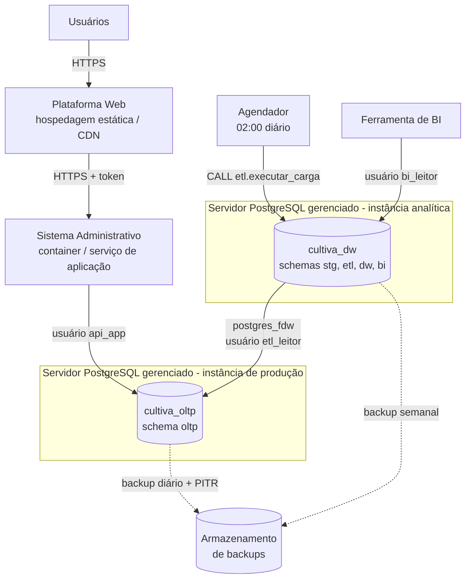
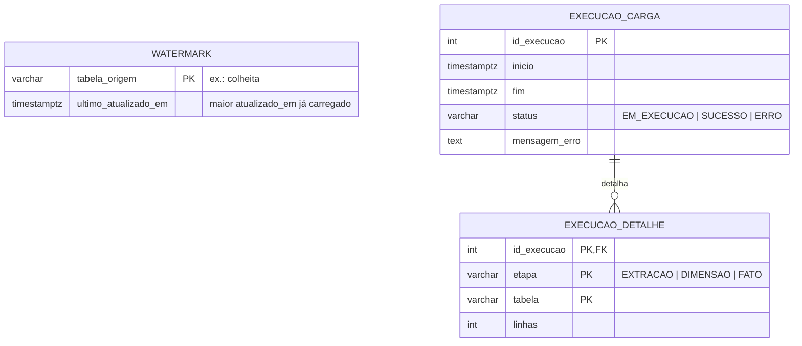

# 6. Infraestrutura e Nuvem

> **Sistema da Entrega 1:** Infraestrutura e Nuvem
> **Responsabilidade:** hospedagem, manutenção e suporte — inclusive dos bancos e do processo de carga.
> **Modelo lógico deste sistema:** onde cada base fica fisicamente, quem acessa o quê (usuários de banco), como as cargas são controladas e por quanto tempo cada dado é guardado.

---

## 6.1 Onde cada dado mora (implantação)

> Na fase inicial (poucas hortas), `cultiva_oltp` e `cultiva_dw` podem ficar **na mesma instância**, em bancos separados — o modelo não muda. Quando o volume crescer, o DW vai para uma instância própria sem alterar nenhum script, só o `oltp_host` do ETL.

## 6.2 Modelo lógico do controle de cargas (schema `etl`)

Exemplo real após a primeira carga com os dados fictícios:

| Etapa | Tabela | Linhas |
|---|---|---:|
| EXTRAÇÃO | colheita | 16 |
| EXTRAÇÃO | presenca_mutirao | 24 |
| DIMENSÃO | dim_horta (novas versões) | 3 |
| FATO | fato_colheita | 16 |
| FATO | fato_ocupacao_mensal | 75 |

**Monitoramento:** se `EXECUCAO_CARGA.status = 'ERRO'`, a equipe de Infraestrutura e DevOps recebe alerta; os dashboards continuam mostrando a última carga válida.

## 6.3 Usuários de banco e privilégios (menor privilégio)

| Usuário de banco | Usado por | `cultiva_oltp` | `cultiva_dw` |
|---|---|---|---|
| `api_app` | Sistema Administrativo | `SELECT/INSERT/UPDATE/DELETE` em `oltp.*`; **sem** `UPDATE/DELETE` em `log_auditoria` | — |
| `etl_leitor` | ETL (via `postgres_fdw`) | **só `SELECT`** nas tabelas analíticas e em `vw_extracao_usuario` (sem nome/e-mail/telefone/senha) | — |
| dono do DW | Agendador do ETL | — | escreve em `stg`, `etl`, `dw`, `bi` |
| `bi_leitor` | Ferramenta de BI | — | **só `SELECT`** no schema `bi` |

Todos esses acessos foram testados nos scripts: o `etl_leitor` recebe *permission denied* ao tentar ler `oltp.usuario`, o `api_app` não consegue apagar `log_auditoria` e o `bi_leitor` não lê `dw.*` diretamente.

> As senhas `troque_esta_senha` dos scripts são apenas para ambiente de desenvolvimento; em produção ficam no cofre de segredos do provedor de nuvem.

## 6.4 Backup, retenção e ambientes

| Dado | Backup | Retenção | Observação |
|---|---|---|---|
| `cultiva_oltp` (dados operacionais) | Completo diário + log contínuo (recuperação a um ponto no tempo) | 30 dias de backups | Fonte da verdade — é o mais crítico |
| `oltp.log_auditoria` | Junto com o OLTP | Mínimo 1 ano (a definir com o cliente) | Depois, exportado para armazenamento frio |
| Usuário desligado | — | Dados pessoais anonimizados após o desligamento (LGPD), mantendo o histórico de cultivos | O DW já não guarda nome/e-mail |
| `cultiva_dw` (dw, bi) | Semanal | 4 semanas | Pode ser **reconstruído** do OLTP zerando `etl.watermark` |
| `stg` (staging) | Não precisa | Apagado a cada carga | Dado temporário |

| Ambiente | Dados | Uso |
|---|---|---|
| Desenvolvimento | Fictícios (`02_oltp_dados_exemplo.sql`) | Programação e testes locais |
| Homologação | Fictícios ou anonimizados | Validação com o cliente |
| Produção | Reais | Uso pelas hortas |
