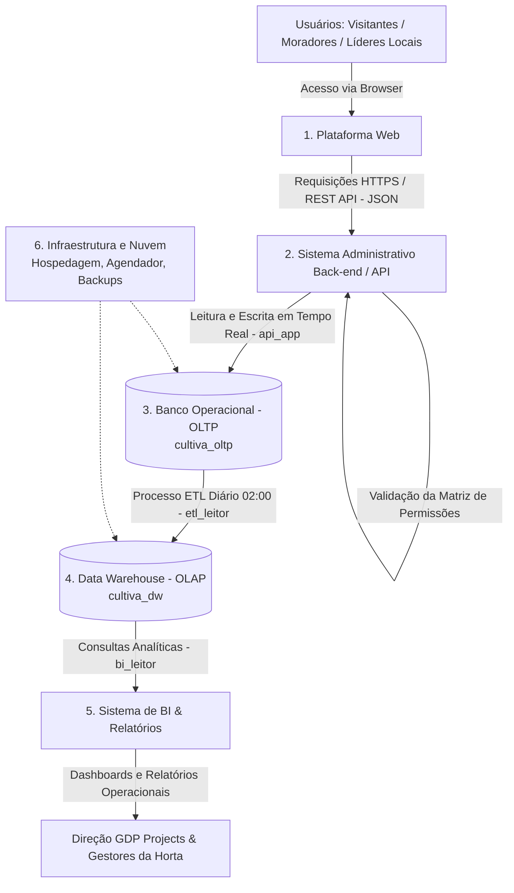
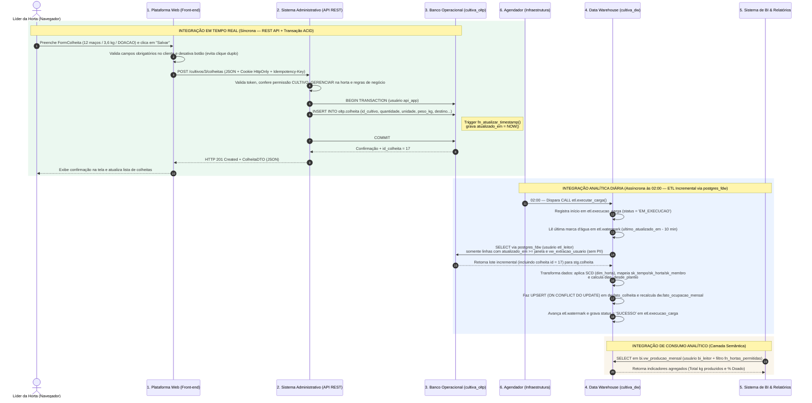

# Entrega 7 — Data Integration (Integração de Dados)

> **Contexto na Arquitetura:** A **Entrega 1 (Data Architecture)** definiu os 6 sistemas do **Cultiva Plus** e o fluxo macro de informação, enquanto a **Entrega 2 (Data Modeling)** detalhou as estruturas lógicas e físicas de cada um. Esta **Entrega 7** especifica como os dados são **transmitidos, compartilhados, transformados e sincronizados** entre todos esses sistemas, garantindo resiliência a falhas e consistência de ponta a ponta.

---

## A. Sistemas Integrados

Na arquitetura do **Cultiva Plus**, as trocas de informações acontecem em **quatro integrações principais** que conectam os sistemas transacionais e analíticos (além da rotina de sincronização das fichas físicas do Modelo de Gestão Documental):

| # | Integração | Sistema que Envia (Origem) | Sistema que Recebe (Destino) | Por que os sistemas precisam trocar informações? |
|---|---|---|---|---|
| **1** | **Web ↔ API (Operacional em Tempo Real)** | **1. Plataforma Web (Front-end)** *(envia ações/formulários)* / **2. Sistema Administrativo (API)** *(envia respostas/consultas)* | **2. Sistema Administrativo (API)** *(recebe comandos)* / **1. Plataforma Web** *(recebe View Models)* | A Plataforma Web não possui banco de dados próprio e nunca acessa o banco diretamente por segurança. Ela precisa enviar os cadastros e registros feitos pelos moradores e líderes (cultivos, colheitas, tarefas, presenças) para a API validar permissões e regras de negócio, além de receber os dados atualizados para exibir nas telas. |
| **2** | **API ↔ Banco Operacional (Persistência Transacional)** | **2. Sistema Administrativo (Back-end / API)** | **3. Banco de Dados Operacional — OLTP (`cultiva_oltp`)** | A API não armazena estado permanente. Ela precisa gravar e consultar em tempo real os registros operacionais nas 19 tabelas normalizadas (3FN) do PostgreSQL usando transações ACID, garantindo que as operações do dia a dia das hortas sejam salvas com integridade e auditoria. |
| **3** | **OLTP → Data Warehouse (Carga Analítica / ETL)** | **3. Banco de Dados Operacional — OLTP (`cultiva_oltp`)** *(lido pela rotina de ETL do DW)* | **4. Data Warehouse — OLAP (`cultiva_dw`)** | O banco operacional é voltado para operações rápidas do dia a dia e não deve sofrer lentidão com relatórios históricos pesados. Os dados precisam ser extraídos periodicamente, limpos de informações pessoais (LGPD) e transformados para o modelo dimensional (esquema estrela) no DW para consolidar o histórico de safras, ocupação de canteiros e engajamento comunitário. |
| **4** | **Data Warehouse → BI & Relatórios (Consumo Analítico)** | **4. Data Warehouse — OLAP (`cultiva_dw` — schema `bi`)** | **5. Sistema de BI & Relatórios** | A ferramenta de BI precisa ler os indicadores já calculados e padronizados na camada semântica (`bi.vw_*`) para montar os dashboards da direção da **GDP Projects** e dos líderes comunitários, aplicando o filtro de permissão por horta sem expor as tabelas internas do DW. |
| **5** *(Apoio)* | **Fichas Físicas → Plataforma Web (Inclusão Digital)** | **Arquivo Físico da Horta** *(Fichas de Canteiro e Listas de Mutirão em papel)* | **1. Plataforma Web → 2. API → 3. OLTP** *(e cópia digitalizada para **6. Infraestrutura/Nuvem**)* | Nem todos os membros comunitários têm internet no momento do plantio ou mutirão. Os registros anotados em papel no local da horta precisam ser lançados pelo líder na plataforma ao final do mês (ou após o evento) para manter o histórico centralizado completo. |

---

## B. Dados Integrados

Abaixo estão definidos os dados enviados, recebidos, formatos, campos obrigatórios e transformações para as principais integrações do sistema (com foco especial na **Integração 1: Web → API** e na **Integração 3: OLTP → DW**).

### B.1 Integração 1: Plataforma Web ↔ Sistema Administrativo (API)

* **Formato dos dados:** `JSON` (*JavaScript Object Notation*), trafegado via protocolo `HTTPS` com codificação `UTF-8`.
* **Quais dados são enviados (Web → API):** Formulários de cadastro de usuário (`FormCadastro`), solicitação de entrada em horta (`FormSolicitacaoEntrada`), abertura de cultivo (`FormCultivo`), registro de colheita (`FormColheita`), agendamento/presença em mutirão (`FormMutirao`) e criação/conclusão de tarefas (`FormTarefa`), acompanhados do cookie de sessão (`HttpOnly`) e chave de idempotência no cabeçalho.
* **Quais dados são recebidos (API → Web):** Confirmação da operação (`HTTP 200/201`) com o recurso criado/atualizado (*DTOs* como `ColheitaDTO`, `CultivoDTO`, `TarefaDTO`) ou *View Models* agregados para renderização das telas (`PainelHortaVM`, `HortaPublicaVM`), além de mensagens padronizadas em caso de erro (`HTTP 400/403/409/422`).

#### Exemplo 1 — Cadastro de Participante (`POST /usuarios`)

**Dados enviados pela Plataforma Web (`FormCadastro`):**
```json
{
    "nome": "João Silva",
    "email": "joao@email.com",
    "telefone": "71999998888",
    "senha": "SenhaForte@2026",
    "aceiteTermos": true
}
```

**Dados recebidos pela Plataforma Web após processamento da API (`UsuarioDTO` — `201 Created`):**
```json
{
    "id": 10,
    "nome": "João Silva",
    "email": "joao@email.com",
    "perfilGlobal": "MEMBRO",
    "status": "PENDENTE",
    "aceiteTermosEm": "2026-11-03T14:10:00Z"
}
```

#### Exemplo 2 — Registro de Colheita (`POST /cultivos/3/colheitas`)

**Dados enviados pela Plataforma Web (`FormColheita`):**
```json
{
    "idCultivo": 3,
    "dataColheita": "2026-11-03",
    "quantidade": 12,
    "unidade": "MACO",
    "pesoKg": 3.60,
    "destino": "DOACAO",
    "encerrarCultivo": false
}
```

**Dados recebidos pela Plataforma Web (`ColheitaDTO` — `201 Created`):**
```json
{
    "id": 17,
    "idCultivo": 3,
    "idUsuarioRegistro": 2,
    "dataColheita": "2026-11-03",
    "quantidade": 12.00,
    "unidade": "MACO",
    "pesoKg": 3.60,
    "destino": "DOACAO",
    "statusCultivo": "EM_ANDAMENTO",
    "atualizadoEm": "2026-11-03T14:15:22Z"
}
```

#### Campos necessários e Transformações na Integração Web → API → OLTP

| Fluxo / Entidade | Campos Obrigatórios (Necessários) | Transformações realizadas durante a integração |
|---|---|---|
| **Cadastro de Usuário** (`USUARIO`) | `nome`, `email`, `senha`, `aceiteTermos` (`telefone` é opcional) | 1. **Normalização:** `email` é convertido para minúsculas (`LOWER(TRIM(email))`) e espaços extras do `nome` são removidos.<br>2. **Criptografia irreversível:** o campo `senha` em texto puro nunca vai para o banco; a API aplica hash **Argon2id/bcrypt** e grava em `senha_hash`.<br>3. **Enriquecimento:** a API converte `aceiteTermos = true` para o timestamp exato `aceite_termos_em = NOW()`, atribui `id_perfil_global = MEMBRO` e `status = 'PENDENTE'`.<br>4. **Filtragem na resposta:** `senha_hash` é removido do JSON devolvido para a Web. |
| **Registro de Colheita** (`COLHEITA`) | `idCultivo`, `dataColheita`, `quantidade`, `unidade` (`KG`, `UNIDADE`, `MACO`), `pesoKg`, `destino` | 1. **Mapeamento de nomenclatura:** conversão de `camelCase` (JSON da Web: `dataColheita`, `pesoKg`) para `snake_case` (colunas SQL do OLTP: `data_colheita`, `peso_kg`).<br>2. **Injeção de contexto autenticado:** `id_usuario_registro` não vem do formulário (para evitar falsificação), sendo extraído diretamente do token de sessão (`TokenClaims.sub`) pela API.<br>3. **Padronização de medida:** garante que mesmo colheitas lançadas em `MACO` ou `UNIDADE` tenham o `peso_kg` numérico correspondente para análises futuras.<br>4. **Atualização encadeada:** se `encerrarCultivo = true`, atualiza `CULTIVO.status = 'COLHIDO'` e recalcula se `CANTEIRO.status` deve voltar para `'DISPONIVEL'`. |
| **Aprovação de Membro** (`SOLICITACAO_ENTRADA`) | `idSolicitacao`, `acao` (`APROVAR` ou `RECUSAR`), `motivoRecusa` (se recusado) | 1. **Desmembramento transacional:** um único comando JSON se transforma em 4 operações no OLTP: atualiza `solicitacao_entrada`, insere vínculo em `membro_horta`, ativa o `usuario` e gera registro JSONB (`dados_anteriores` e `dados_novos`) em `log_auditoria`. |

---

### B.2 Integração 3: Banco Operacional (OLTP) → Data Warehouse (OLAP)

* **Formato dos dados:** Registros tabulares tipados do PostgreSQL trafegados via protocolo nativo do banco (`libpq` / `postgres_fdw`) entre `cultiva_oltp` e `cultiva_dw`.
* **Quais dados são enviados (OLTP → Staging do DW):** Apenas os registros das tabelas operacionais analíticas (`comunidade`, `horta`, `canteiro`, `especie`, `cultivo`, `colheita`, `mutirao`, `presenca_mutirao`, `tipo_tarefa`, `tarefa`) e da view segura `vw_extracao_usuario` cujo campo `atualizado_em` seja maior ou igual à última marca d'água (`etl.watermark`).
* **Quais dados são recebidos (Esquema Estrela do DW):** Linhas consolidadas nas 6 dimensões (`dim_tempo`, `dim_horta`, `dim_canteiro`, `dim_especie`, `dim_membro`, `dim_tipo_tarefa`) e nas 5 tabelas fato (`fato_colheita`, `fato_cultivo`, `fato_ocupacao_mensal`, `fato_participacao_mutirao`, `fato_tarefa`).

#### Exemplo de Transformação na Integração OLTP → DW (Registro de Usuário e Colheita)

**1. Como o dado está no OLTP (`oltp.usuario` e `oltp.colheita`):**
```json
{
    "oltp_usuario": {
        "id_usuario": 10,
        "nome": "João Silva",
        "email": "joao@email.com",
        "telefone": "71999998888",
        "senha_hash": "$argon2id$v=19$m=65536...",
        "id_perfil_global": 3,
        "status": "ATIVO",
        "aceite_termos_em": "2026-11-03T14:10:00Z",
        "atualizado_em": "2026-11-03T14:12:00Z"
    },
    "oltp_colheita": {
        "id_colheita": 17,
        "id_cultivo": 3,
        "id_usuario_registro": 10,
        "data_colheita": "2026-11-03",
        "quantidade": 12.00,
        "unidade": "MACO",
        "peso_kg": 3.60,
        "destino": "DOACAO"
    }
}
```

**2. Como o dado chega e é gravado no Data Warehouse (`dw.dim_membro` e `dw.fato_colheita`):**
```json
{
    "dw_dim_membro": {
        "sk_membro": 8,
        "id_usuario_origem": 10,
        "perfil_global": "MEMBRO",
        "status": "ATIVO",
        "data_cadastro": "2026-11-03"
    },
    "dw_fato_colheita": {
        "id_colheita_origem": 17,
        "id_cultivo_origem": 3,
        "sk_tempo": 20261103,
        "sk_horta": 1,
        "sk_canteiro": 2,
        "sk_especie": 1,
        "sk_membro": 8,
        "destino": "DOACAO",
        "quantidade": 12.00,
        "peso_kg": 3.60,
        "dias_desde_plantio": 49
    }
}
```

#### Resumo das Transformações no ETL (`OLTP → DW`)

1. **Anonimização / Pseudonimização (LGPD):** `nome`, `email`, `telefone` e `senha_hash` são **bloqueados na origem** pela view `oltp.vw_extracao_usuario`. O DW recebe apenas o `id_usuario` numérico, o código do perfil, o status e a data de cadastro.
2. **Desnormalização:** tabelas separadas na 3FN (como `oltp.horta` + `oltp.comunidade`, ou `oltp.colheita` + `oltp.cultivo` + `oltp.canteiro`) são unidas (`JOIN`) para formar dimensões completas (`dim_horta`) e fatos já enriquecidos com todas as chaves de contexto.
3. **Troca de Chaves Naturais por Chaves Substitutas (*Surrogate Keys*):** os identificadores do operacional (`id_horta`, `id_canteiro`, `id_especie`, `id_usuario`) são convertidos para `sk_horta`, `sk_canteiro`, `sk_especie`, `sk_membro`, e as datas (`2026-11-03`) são convertidas para o inteiro `sk_tempo` (`20261103`). Chaves opcionais nulas (ex.: tarefa sem responsável) são mapeadas para `sk = -1` (*"Não informado"*).
4. **Versionamento Histórico (SCD Tipo 2):** se uma horta mudou de status ou de área total no OLTP, o ETL fecha a vigência do registro anterior em `dim_horta` (`data_fim_validade = ontem`, `registro_atual = false`) e abre uma nova linha com novo `sk_horta`, preservando o histórico fiel das safras antigas.
5. **Cálculo de Métricas Derivadas:** cálculo automático de `dias_desde_plantio` (em `fato_colheita`), `ciclo_previsto_dias`, `ciclo_real_dias`, `flag_perdido` e `total_colhido_kg` (em `fato_cultivo`), `horas_participacao` (em `fato_participacao_mutirao`), `flag_no_prazo` e `flag_atrasada` (em `fato_tarefa`), e agregação mensal da área plantada em `fato_ocupacao_mensal`.

---

## C. Forma de Integração

Como o **Cultiva Plus** possui tanto operações em tempo real (uso pelos moradores) quanto processamento analítico (relatórios da gestão), utilizamos **uma combinação de mecanismos de integração**, escolhendo o mais adequado para cada camada da arquitetura:

| Integração | Mecanismo Escolhido | Protocolo / Tecnologia | Papel na Arquitetura |
|---|---|---|---|
| **1. Plataforma Web ↔ Sistema Administrativo** | **REST API** | `HTTPS` (TLS 1.3) + payloads `JSON` + Cookie `HttpOnly` | Comunicação síncrona cliente-servidor para todas as telas e formulários da aplicação web. |
| **2. Sistema Administrativo ↔ Banco Operacional (OLTP)** | **Banco de Dados (Conexão Direta via Pool Transacional)** | Protocolo PostgreSQL (`TCP/TLS`) com consultas parametrizadas e usuário restrito `api_app` | Leitura e escrita imediata com suporte a transações ACID em múltiplas tabelas. |
| **3. Banco Operacional (OLTP) → Data Warehouse (OLAP)** | **Banco de Dados (ETL Batch Incremental via FDW)** | `postgres_fdw` (*Foreign Data Wrapper*) acionado por agendador diário (`02:00`) via usuário somente leitura `etl_leitor` | Sincronização periódica em lote (*batch*) do que mudou no OLTP para o DW sem precisar de servidores intermediários extras. |
| **4. Data Warehouse → Sistema de BI & Relatórios** | **Banco de Dados (Camada Semântica de Views SQL)** | Conexão somente leitura (`bi_leitor`) sobre as views do schema `bi.*` | Exposição segura de indicadores padronizados para os painéis de BI. |
| **5. Fichas em Papel → Plataforma / Nuvem** | **Arquivo Digitalizado + Entrada via REST API** | Formulário Web (`REST API`) para os dados + upload de imagem/PDF para Object Storage (`S3 / Cloud Storage`) | Sincronização mensal dos registros físicos das hortas com o banco central. |

### Por que esses mecanismos são adequados ao projeto?

1. **Por que REST API entre a Plataforma Web e o Back-end?**
   * **Padrão universal e desacoplamento:** a REST API sobre HTTPS com JSON é suportada nativamente por qualquer navegador celular ou computador (essencial para moradores que acessam pelo smartphone na horta).
   * **Segurança centralizada:** impede que o navegador acesse o banco diretamente. Toda validação de permissão (Matriz de Perfis) e regra de negócio fica concentrada em um único ponto antes de tocar nos dados.
   * **Baixo custo e simplicidade:** não exige infraestrutura complexa, alinhando-se à realidade de orçamento enxuto das hortas comunitárias e à agilidade da **GDP Projects**.

2. **Por que Conexão de Banco de Dados com ETL via `postgres_fdw` (OLTP → DW) em vez de Mensageria ou Webhooks?**
   * **Adequação ao ritmo do negócio:** relatórios analíticos de safras, ocupação mensal de canteiros e horas de voluntariado são analisados por dia, mês ou estação do ano — não exigem atualização a cada segundo. Uma carga diária às `02:00` da manhã atende 100% da necessidade da direção e dos líderes.
   * **Economia de recursos e manutenção zero:** como tanto o `cultiva_oltp` quanto o `cultiva_dw` utilizam **PostgreSQL 16** (conforme definido na Entrega 2 e na Entrega 5), o recurso nativo `postgres_fdw` permite que o DW busque os dados incrementais diretamente do OLTP em uma única transação SQL (`CALL etl.executar_carga()`). Não há custo nem complexidade de manter corretores de mensageria (como Kafka ou RabbitMQ) ou servidores externos de ETL (como Airflow) para um volume esperado abaixo de 500 MB.
   * **Isolamento e segurança:** o acesso é feito pelo usuário `etl_leitor`, que possui apenas permissão `SELECT` nas tabelas necessárias e lê os membros pela view `vw_extracao_usuario` (que oculta nome, e-mail, telefone e senha).

3. **Por que não usamos Mensageria ou Webhooks neste momento?**
   * **Mensageria (filas assíncronas)** adicionaria custo de hospedagem e complexidade operacional sem ganho real para o volume atual do projeto (dezenas de hortas, ~15 canteiros por horta).
   * **Webhooks** são indicados quando sistemas externos precisam notificar nossa plataforma sobre eventos (ex.: confirmação de pagamento). Como o Cultiva Plus atualmente não depende de APIs pagas de terceiros, não há necessidade de webhooks na fase atual, embora a API REST esteja pronta para recebê-los no futuro.

---

## D. Fluxo de Dados

Abaixo apresentamos:
1. O **desenho feito anteriormente** na Arquitetura e Modelagem de Dados (visão geral dos 6 sistemas); e
2. O **novo desenho detalhado do fluxo de uma integração** passo a passo (mostrando o caminho completo de um registro de colheita desde o formulário na Web, passando pela API e OLTP em tempo real, até a sincronização incremental da madrugada para o Data Warehouse e exibição no BI).

### D.1 Desenho Feito Anteriormente (Visão Geral da Arquitetura — Entregas 1 e 2)



### D.2 Desenho Detalhado do Fluxo de uma Integração (Ponta a Ponta: Tempo Real + Sincronização ETL)

O diagrama abaixo demonstra em detalhe o que acontece dentro de cada integração quando um **Líder da Horta registra uma colheita** (Fluxo Síncrono via REST API) e como esse dado é **sincronizado e transformado para o Data Warehouse e BI** (Fluxo Assíncrono/Batch via ETL):



---

## E. Tratamento de Erros

Para garantir que nenhuma informação das hortas seja perdida ou corrompida, o **Cultiva Plus** define estratégias específicas para cada cenário de falha, tanto na integração online (**Web ↔ API ↔ OLTP**) quanto na integração analítica (**OLTP → DW**):

| Cenário de Falha | O que acontece na Integração Online (`Web ↔ API ↔ OLTP`) | O que acontece na Integração Analítica (`OLTP → DW / ETL`) |
|---|---|---|
| **1. Sistema de destino indisponível** *(ex.: API ou banco fora do ar)* | • Se a **API** ou o **OLTP** estiverem indisponíveis, a Plataforma Web recebe erro de conexão ou `HTTP 503 Service Unavailable`, exibe um aviso amigável ao usuário e mantém os dados preenchidos no formulário em memória para nova tentativa.<br>• No servidor gerenciado de nuvem, o provedor aciona o *failover* automático para a instância reserva.<br>• **Plano de contingência físico:** se a indisponibilidade ocorrer durante um mutirão ou plantio no campo, o líder registra na **Ficha em Papel** da horta e lança no sistema quando o serviço normalizar. | • Se o `cultiva_oltp` estiver inacessível às `02:00`, a conexão via `postgres_fdw` falha logo na etapa de extração.<br>• O bloco `EXCEPTION` da procedure `etl.executar_carga()` captura o erro, aborta a carga, mantém `etl.watermark` intacta e grava `status = 'ERRO'` com a mensagem técnica em `etl.execucao_carga`.<br>• A equipe de Infraestrutura/DevOps recebe um alerta, e os dashboards do BI continuam funcionando normalmente com os dados válidos da carga anterior. |
| **2. Dados inválidos** *(ex.: peso negativo, data incoerente, campo faltando)* | • **1ª barreira (Web):** o formulário impede o envio e destaca o campo incorreto.<br>• **2ª barreira (API):** se a requisição chegar via API com formato inválido ou violar regra de negócio (ex.: área plantada maior que o canteiro), a API rejeita imediatamente com `HTTP 400 Bad Request` ou `HTTP 422 Unprocessable Entity` explicando o motivo, sem abrir transação no banco.<br>• **3ª barreira (OLTP):** constraints `NOT NULL`, `CHECK (peso_kg > 0)` e `FOREIGN KEY` no PostgreSQL bloqueiam qualquer dado inválido. | • Como os dados do OLTP já passaram pelas restrições do banco operacional, erros de domínio são raros.<br>• Caso alguma chave opcional venha nula (ex.: `id_responsavel IS NULL` em uma tarefa) ou ainda não exista na dimensão, o ETL utiliza `COALESCE(..., -1)` para vincular ao registro padrão **`-1 = "Não informado"`**, evitando que a carga falhe ou perca linhas. |
| **3. Timeout** *(tempo limite excedido)* | • A requisição HTTP entre Web e API possui timeout configurado (ex.: `10s`), e as transações da API no OLTP possuem `statement_timeout` (ex.: `5s`).<br>• Se o tempo esgotar, a conexão é encerrada, o PostgreSQL faz `ROLLBACK` automático da transação em andamento e a Web orienta o usuário a tentar novamente (usando a mesma chave de idempotência). | • A sessão do ETL configura um timeout adequado para lote (ex.: `5 min`).<br>• Se uma consulta de extração ou agregação travar por bloqueio (*lock*) e exceder o tempo, toda a execução da carga sofre `ROLLBACK`, a marca d'água não avança e o agendador reprocessa na janela seguinte. |
| **4. Dados duplicados** *(ex.: clique duplo no botão ou reexecução do ETL)* | • **Na Web:** o botão *"Salvar"* é desabilitado imediatamente após o primeiro clique.<br>• **Na API:** requisições de criação enviam um cabeçalho `Idempotency-Key` (UUID gerado pelo formulário); se a mesma chave chegar duas vezes em curto intervalo, a API devolve o resultado já processado sem inserir de novo.<br>• **No OLTP:** restrições `UNIQUE` (`uk_usuario_email`, `uk_membro_horta`, `uk_canteiro_horta_cod`, `pk_presenca_mutirao`) impedem duplicidade no nível físico, retornando `HTTP 409 Conflict`. | • As tabelas de staging (`stg.*`) sofrem `TRUNCATE` no início de cada extração.<br>• Nas dimensões e nos fatos do DW, a carga utiliza `INSERT ... ON CONFLICT (id_origem) DO UPDATE` (*Upsert*). Assim, mesmo que o ETL seja executado 2, 3 ou 10 vezes seguidas sobre o mesmo período, **nenhum registro é duplicado** — ele apenas atualiza a linha existente. |
| **5. Falha durante a transmissão** *(ex.: queda do 4G do morador no meio do envio)* | • Toda comunicação usa `HTTPS/TLS`, que possui soma de verificação (*checksum*) pacote a pacote: pacotes corrompidos ou incompletos são descartados pela camada de rede e o JSON incompleto nunca é processado pela API.<br>• Como a transação não se completa, nada é gravado no banco operacional. | • O protocolo interno do `postgres_fdw` trafega sobre conexão TCP segura entre os bancos. Se a conexão cair no meio da transferência das linhas para o schema `stg`, a transação inteira falha e nenhum dado parcial chega às tabelas `dw.dim_*` ou `dw.fato_*`. |
| **6. Falha ao salvar os dados** *(ex.: falha em uma das 4 tabelas ao aprovar membro)* | • Todas as operações que alteram mais de uma tabela (como aprovar membro ou encerrar cultivo após colheita) rodam dentro de um único bloco transacional (`BEGIN ... COMMIT`).<br>• Se ocorrer erro ao gravar na 3ª ou 4ª tabela (ex.: falha ao inserir em `log_auditoria`), o banco executa `ROLLBACK` completo: **ou tudo é salvo por inteiro, ou nada é alterado**. | • A carga de dimensões e fatos e a atualização da tabela `etl.watermark` ocorrem de forma coordenada na procedure `etl.executar_carga()`.<br>• Se ocorrer falha ao salvar qualquer tabela fato, todas as alterações daquela execução no schema `dw` são desfeitas (`ROLLBACK`) e a `watermark` permanece no ponto anterior, garantindo que na próxima tentativa tudo seja reprocessado desde o ponto exato onde parou. |

### Registro de Erros de Carga no Data Warehouse (`etl.execucao_carga`)

Quando uma integração do ETL falha, o erro fica registrado para diagnóstico imediato da equipe de **Infraestrutura e DevOps**:

```sql
-- Exemplo do que fica gravado em etl.execucao_carga quando ocorre uma falha:
-- id_execucao | inicio               | fim                  | status | mensagem_erro
-- ------------+----------------------+----------------------+--------+---------------------------------------------------
--          14 | 2026-11-03 02:00:01  | 2026-11-03 02:00:06  | ERRO   | could not connect to server "oltp_server": timeout
```

---

## F. Consistência dos Dados

A consistência dos dados entre a Plataforma Web, o Banco Operacional (OLTP), o Data Warehouse (OLAP) e o Sistema de BI é garantida pelos seguintes mecanismos arquiteturais e de modelagem:

### 1. Como garantir que os dados recebidos estejam corretos?
Aplicamos **validação em três camadas independentes (Defesa em Profundidade)**, além de reconciliação na carga analítica:
* **Na entrada (Web e API):** validação de tipos de dados, campos obrigatórios, formatos (e-mail, datas ISO-8601) e regras de domínio (ex.: a soma de `area_ocupada_m2` dos cultivos ativos não pode ultrapassar `CANTEIRO.area_m2`; um membro só pode concluir tarefas das quais é responsável; um líder só altera registros da horta onde possui vínculo `LIDER_HORTA` ativo).
* **No armazenamento operacional (OLTP):** uso rigoroso de chaves estrangeiras (`FOREIGN KEY`) que impedem registros órfãos (não existe colheita sem cultivo, nem cultivo sem canteiro e espécie), tipos exatos (`NUMERIC` para áreas em m² e pesos em kg, evitando erros de arredondamento) e cláusulas `CHECK` para listas fechadas de status, unidades e destinos (`CONSUMO_MEMBROS`, `DOACAO`, `FEIRA_TROCA`, `COMPOSTAGEM`).
* **Na carga analítica (DW):** conferência automática do volume de linhas extraídas × carregadas registrada na tabela `etl.execucao_detalhe` e padronização de fuso horário (`America/Bahia`) e unidades (`peso_kg`).

### 2. Como evitar duplicidade?
* **Chaves únicas de negócio no OLTP (`UNIQUE`):** o banco bloqueia fisicamente dois usuários com o mesmo `email`, dois vínculos ativos do mesmo usuário na mesma horta (`id_usuario`, `id_horta`), dois canteiros com o mesmo código na mesma horta (`id_horta`, `codigo`), duas espécies com o mesmo `nome_cientifico` e duas confirmações da mesma pessoa no mesmo mutirão (`id_mutirao`, `id_usuario`).
* **Tabelas de referência padronizadas:** `ESPECIE` e `TIPO_TAREFA` são catálogos fechados, evitando que grafias diferentes (*"Alface crespa"*, *"alface"*, *"ALFACE"*) gerem duplicidade nos relatórios.
* **Idempotência no ETL (`ON CONFLICT DO UPDATE`):** todas as tabelas de dimensão (SCD1) e tabelas fato do Data Warehouse possuem restrição `UNIQUE` sobre a chave de origem do OLTP (`id_colheita_origem`, `id_cultivo_origem`, `id_tarefa_origem`, etc.). O comando de carga usa `ON CONFLICT ... DO UPDATE`, garantindo que reprocessar um lote nunca crie linhas duplicadas.
* **Controle de Fichas Físicas:** cada ficha de papel possui código único (`Horta + Canteiro + Mês/Ano`), impedindo que o líder digite a mesma ficha duas vezes na plataforma.

### 3. Como identificar uma atualização?
* **Marca d'água temporal (`atualizado_em` + Trigger automática):** todas as tabelas mutáveis do banco operacional possuem a coluna `atualizado_em TIMESTAMPTZ NOT NULL DEFAULT NOW()`. Uma trigger de banco (`oltp.fn_atualizar_timestamp()`) atualiza esse campo automaticamente em qualquer `UPDATE`.
* **Janela incremental com margem de segurança (*Overlap* de 10 minutos):** a tabela `etl.watermark` no Data Warehouse guarda o maior `atualizado_em` já processado de cada tabela. Na carga seguinte, o ETL busca:
  $$\text{atualizado\_em} \ge (\text{ultimo\_atualizado\_em} - 10\text{ minutos})$$
  Essa sobreposição de 10 minutos garante que mesmo uma transação longa que começou antes da carga anterior e terminou segundos depois seja capturada na carga seguinte, e o *Upsert* garante que a releitura desses 10 minutos apenas atualize os registros sem duplicar.
* **Detecção de mudança de histórico em Dimensões (SCD Tipo 2):** em `dw.dim_horta`, o ETL compara os atributos atuais da horta no OLTP (`status`, `area_total_m2`, `nome`, `comunidade`) com o registro vigente no DW (`registro_atual = TRUE` via operador `IS DISTINCT FROM`). Se houve mudança, o sistema identifica a atualização, encerra a versão antiga e cria uma nova versão com validade a partir da data atual.
* **Rastreabilidade de valores anteriores e novos:** para mudanças críticas de segurança e gestão no OLTP, a tabela `oltp.log_auditoria` grava o estado exato antes (`dados_anteriores` em `JSONB`) e depois (`dados_novos` em `JSONB`) da atualização.

### 4. Como tratar dados inconsistentes entre os sistemas?
* **Fonte Única da Verdade (*Single Source of Truth*):** o banco operacional **`cultiva_oltp`** é sempre a fonte oficial e definitiva dos dados do Cultiva Plus. Nenhum dado nasce diretamente no Data Warehouse ou no BI.
* **Exclusão Lógica (*Soft Delete*) para não quebrar referências históricas:** no OLTP, registros operacionais que já possuem histórico (como um usuário que se desligou, uma horta desativada, um canteiro em descanso ou uma tarefa cancelada) **não sofrem `DELETE` físico** — apenas mudam seu `status` (`INATIVO`, `DESLIGADO`, `CANCELADA`). Assim, o Data Warehouse nunca fica com fatos apontando para chaves que deixaram de existir no operacional.
* **Tratamento de chaves ausentes (*Late Arriving Dimensions / Membro `-1`*):** toda dimensão no DW possui o registro coringa `sk = -1` (*"Não informado"*). Se um registro operacional tiver um relacionamento opcional vazio (como uma tarefa ainda sem responsável), ele é ligado ao `sk = -1`, mantendo a integridade referencial do esquema estrela e garantindo que a soma das tarefas no BI bata 100% com o OLTP.
* **Reconciliação e Reconstrução Total (*Full Reload*):** como todo o histórico operacional permanece salvo no `cultiva_oltp`, caso seja detectada qualquer divergência entre os números do OLTP e os painéis do BI (por exemplo, após uma manutenção ou mudança de regra de cálculo), basta zerar a tabela `etl.watermark` para `1970-01-01` e executar `CALL etl.executar_carga()`. O ETL reconstrói e reconcilia automaticamente todas as dimensões e fatos do Data Warehouse a partir da fonte oficial em poucos segundos, sem perda de dados.

