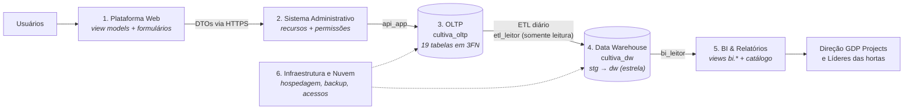
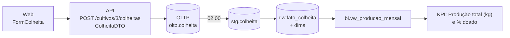

# Entrega 2 — Data Modeling (Modelagem de Dados)

A **Entrega 1** (no [README principal](../../README.md#arquitetura-de-dados-entrega-1)) mostrou a **visão macro**: quais sistemas existem e como os dados circulam entre eles. Esta entrega mostra a **visão estrutural/detalhada**: o **modelo lógico de cada um desses sistemas** e **como os dados são armazenados** em cada banco.

Todos os modelos foram implementados em SQL (PostgreSQL 16) e **testados de ponta a ponta** com dados fictícios: criação dos bancos → carga de exemplo → ETL → consultas do BI.

---

## 1. Coerência com a Data Architecture (Entrega 1)

Cada sistema levantado na Entrega 1 tem o seu modelo lógico:

| # | Sistema (Entrega 1) | Tem banco próprio? | Modelo lógico apresentado | Documento | Script |
|---|---|---|---|---|---|
| 1 | Plataforma Web (Front-end) | Não | Sessão, *view models* das telas e formulários | [01-plataforma-web.md](01-plataforma-web.md) | — |
| 2 | Sistema Administrativo (API) | Não (único acesso ao OLTP) | Recursos/DTOs, matriz de permissões e regras de negócio | [02-sistema-administrativo-api.md](02-sistema-administrativo-api.md) | — |
| 3 | Banco Operacional (OLTP) | **Sim** — `cultiva_oltp` | Modelo **relacional normalizado (3FN)**, 19 entidades | [03-banco-operacional-oltp.md](03-banco-operacional-oltp.md) | [`01`](sql/01_oltp_schema.sql), [`02`](sql/02_oltp_dados_exemplo.sql) |
| 4 | Data Warehouse (OLAP) | **Sim** — `cultiva_dw` | Modelo **dimensional** (5 fatos, 6 dimensões) + ETL | [04-data-warehouse-olap.md](04-data-warehouse-olap.md) | [`03`](sql/03_dw_schema.sql), [`04`](sql/04_etl_oltp_para_dw.sql) |
| 5 | Sistema de BI & Relatórios | Usa o schema `bi` do DW | Camada semântica (views) + catálogo de painéis/KPIs e acesso por horta | [05-bi-relatorios.md](05-bi-relatorios.md) | [`05`](sql/05_bi_camada_semantica.sql), [`06`](sql/06_consultas_exemplo.sql) |
| 6 | Infraestrutura e Nuvem | Hospeda os dois bancos | Implantação, usuários de banco, controle de cargas, backup e retenção | [06-infraestrutura-nuvem.md](06-infraestrutura-nuvem.md) | — |

### Onde cada modelo fica no fluxo da Entrega 1



---

## 2. Entidades escolhidas

O enunciado pede **pelo menos 10 entidades**. Modelamos **12 entidades de negócio** e **7 de apoio** (total de 19 tabelas no OLTP).

| # | Entidade de negócio | O que representa | Vem da necessidade do README |
|---|---|---|---|
| 1 | `USUARIO` | Pessoa cadastrada na plataforma | Dados dos participantes e membros |
| 2 | `COMUNIDADE` | Associação, escola ou condomínio que mantém hortas | Conectar moradores, comunidades e responsáveis |
| 3 | `HORTA` | Horta comunitária | Informações das hortas |
| 4 | `MEMBRO_HORTA` | Vínculo usuário × horta e o papel (líder/membro) | Matriz de Perfis e Permissões |
| 5 | `SOLICITACAO_ENTRADA` | Pedido para participar de uma horta | "Aprovação de novos membros" |
| 6 | `CANTEIRO` | Espaço de cultivo dentro da horta | Informações dos espaços disponíveis |
| 7 | `ESPECIE` | Catálogo de plantas | Informações sobre os cultivos |
| 8 | `CULTIVO` | Um plantio (safra) em um canteiro | Acompanhamento dos cultivos |
| 9 | `COLHEITA` | Cada colheita e o destino da produção | Histórico de safras |
| 10 | `MUTIRAO` | Evento coletivo de trabalho | Atividades realizadas |
| 11 | `PRESENCA_MUTIRAO` | Confirmação e presença em mutirão | Participação dos membros |
| 12 | `TAREFA` | Atividade atribuída a um membro | Organização das atividades |

**Apoio:** `PERFIL`, `PERMISSAO`, `PERFIL_PERMISSAO` (permissões), `TIPO_TAREFA` (padroniza tarefas), `DICA_CULTIVO` (compartilhamento de conhecimento), `AVISO` (comunicação local moderada) e `LOG_AUDITORIA` (logs exigidos pela Matriz).

---

## 3. Matriz entidade × sistema

Mostra, para cada entidade, o papel de cada sistema — e confirma que o modelo segue a arquitetura (a Web nunca acessa banco; o BI nunca lê o OLTP).

| Entidade | 1. Web | 2. API | 3. OLTP | 4. DW | 5. BI |
|---|---|---|---|---|---|
| `USUARIO` | `FormCadastro`, `UsuarioLogado` | valida, gera hash da senha | `oltp.usuario` | `dim_membro` (sem dados pessoais) | contagem de membros |
| `COMUNIDADE` + `HORTA` | `HortaPublicaVM` (mapa) | `HortaDTO` | `oltp.comunidade`, `oltp.horta` | `dim_horta` (SCD2) | filtro em todos os painéis |
| `MEMBRO_HORTA` | `VinculoHorta` | checagem de permissão | `oltp.membro_horta` | — (perfil vai em `dim_membro`) | `bi.acesso_horta` (quem vê qual horta) |
| `SOLICITACAO_ENTRADA` | `FormSolicitacaoEntrada` | aprovação em transação | `oltp.solicitacao_entrada` | — (evolução futura) | — |
| `CANTEIRO` | `CanteiroVM` | `CanteiroDTO` | `oltp.canteiro` | `dim_canteiro` | `vw_ocupacao_mensal` |
| `ESPECIE` | `CultivoVM.especie` | catálogo | `oltp.especie` | `dim_especie` | `vw_desempenho_safra` |
| `CULTIVO` | `FormCultivo`, `CultivoVM` | regra de área do canteiro | `oltp.cultivo` | `fato_cultivo`, `fato_ocupacao_mensal` | `vw_desempenho_safra`, `vw_ocupacao_mensal` |
| `COLHEITA` | `FormColheita` | `ColheitaDTO` | `oltp.colheita` | `fato_colheita` | `vw_producao_mensal` |
| `MUTIRAO` + `PRESENCA_MUTIRAO` | `MutiraoVM`, `FormMutirao` | controle de vagas | `oltp.mutirao`, `oltp.presenca_mutirao` | `fato_participacao_mutirao` | `vw_engajamento_mutiroes` |
| `TAREFA` + `TIPO_TAREFA` | `TarefaVM`, `FormTarefa` | só o responsável conclui | `oltp.tarefa`, `oltp.tipo_tarefa` | `fato_tarefa`, `dim_tipo_tarefa` | `vw_desempenho_tarefas` |
| `PERFIL` / `PERMISSAO` | `UsuarioLogado.permissoes` | matriz de permissões | `oltp.perfil*`, `oltp.permissao` | — | — |
| `DICA_CULTIVO`, `AVISO` | telas de dicas e avisos | moderação | `oltp.dica_cultivo`, `oltp.aviso` | — (texto, sem métrica) | — |
| `LOG_AUDITORIA` | — | grava em ações sensíveis | `oltp.log_auditoria` | — (segurança, não análise) | — |

### Exemplo: o caminho de uma colheita por todos os sistemas



---

## 4. Estrutura da pasta

```bash
docs/entrega-2-data-modeling/
├── README.md                          # este arquivo (visão geral e coerência)
├── 01-plataforma-web.md               # Sistema 1
├── 02-sistema-administrativo-api.md   # Sistema 2
├── 03-banco-operacional-oltp.md       # Sistema 3
├── 04-data-warehouse-olap.md          # Sistema 4 (+ ETL: quais dados, como saem, finalidade)
├── 05-bi-relatorios.md                # Sistema 5
├── 06-infraestrutura-nuvem.md         # Sistema 6
└── sql/
    ├── 01_oltp_schema.sql             # modelo físico do OLTP
    ├── 02_oltp_dados_exemplo.sql      # dados fictícios para teste
    ├── 03_dw_schema.sql               # staging, controle de ETL e esquema estrela
    ├── 04_etl_oltp_para_dw.sql        # extração incremental + carga
    ├── 05_bi_camada_semantica.sql     # views e catálogo do BI
    └── 06_consultas_exemplo.sql       # perguntas de negócio respondidas
```

## 5. Como executar (PostgreSQL 16)

```bash
cd docs/entrega-2-data-modeling/sql
createdb cultiva_oltp
createdb cultiva_dw

psql -d cultiva_oltp -f 01_oltp_schema.sql
psql -d cultiva_oltp -f 02_oltp_dados_exemplo.sql

psql -d cultiva_dw -f 03_dw_schema.sql
psql -d cultiva_dw -f 04_etl_oltp_para_dw.sql      # opcional: -v oltp_host=... -v oltp_senha=...
psql -d cultiva_dw -f 05_bi_camada_semantica.sql

psql -d cultiva_dw -c "CALL etl.executar_carga();"  # roda o ETL
psql -d cultiva_dw -f 06_consultas_exemplo.sql     # mostra os indicadores
```

> Os nomes de pessoas, hortas e endereços dos dados de exemplo são **fictícios**.
